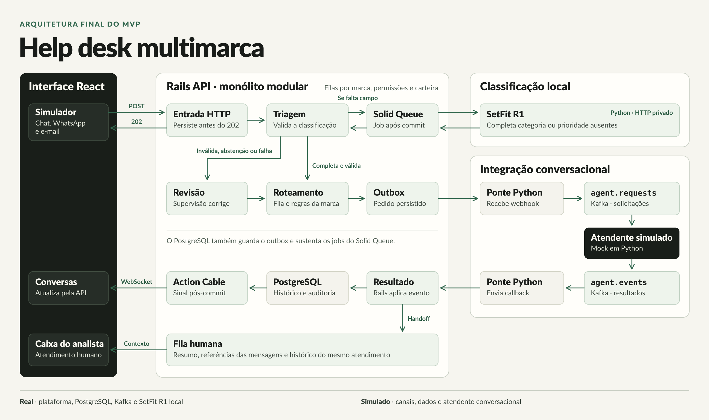

# Arquitetura

## Fluxo de uma mensagem

1. O webhook HTTP valida a assinatura e identifica a marca pelo canal.
   O simulador usa a API com sessão e CSRF. Os dois caminhos persistem a entrada
   antes de devolver `202` e reaproveitam o recibo de uma reentrega idêntica.
2. O Rails valida categoria e prioridade no catálogo da marca. Solid Queue
   executa a classificação de campos ausentes. O SetFit preserva os valores
   válidos do canal e o Rails encaminha a decisão incerta ou inválida para a
   supervisão. A primeira regra ativa compatível define a fila inicial.
3. O Rails salva a rodada e o outbox na mesma transação PostgreSQL. O outbox
   é o registro durável do pedido ainda a publicar. A ponte Python envia o
   pedido ao tópico `agent.requests` e espera a confirmação do Kafka.
4. O atendente simulado lê o pedido e publica uma proposta em `agent.events`.
   A ponte entrega o resultado ao Rails, que valida a rodada e persiste o
   efeito uma vez. As mensagens e a auditoria ficam no PostgreSQL. O Action
   Cable avisa o React via WebSocket para buscar o estado atualizado na API.
5. No encaminhamento humano, o caso mantém o histórico, o resumo e as
   referências às mensagens que motivaram a transferência. O analista responde
   pelo painel e o cliente recebe a mensagem na mesma conversa.

O Rails concentra as regras e o estado da operação. O Kafka integra consumidores
assíncronos e retém os eventos conforme a configuração do tópico. Solid Queue
executa trabalhos internos do Rails. Uma fila de atendimento representa trabalho
da equipe e tem suas próprias regras.

## Marca, fila e responsabilidade

- Um atendimento pertence a uma marca e tem uma fila ativa e, quando atribuído,
  um responsável principal. Uma fila pode ter várias equipes responsáveis
  autorizadas naquela marca. Uma equipe pode operar em várias marcas.
- A categoria identifica o assunto, como Pix, Repasses ou Maquininha. A
  prioridade indica a precedência operacional. A demonstração usa Básica,
  Intermediária, Avançada e Urgente. Os perfis de capacidade combinam categoria
  e prioridade, com limite da carteira para os casos em espera.
- A distribuição escolhe o elegível com menos casos ativos. No empate, ganha
  quem está há mais tempo sem nova atribuição. A espera libera capacidade
  ativa e conserva a vaga na carteira. Para trocar de marca, o analista conclui
  ou transfere os casos sob sua responsabilidade.
- O analista consulta as filas autorizadas à sua equipe e responde aos casos
  pelos quais é responsável na marca em operação. A supervisão configura as
  marcas autorizadas e acompanha as decisões na auditoria.

## Contratos e auditoria

| Interface | Fonte |
| --- | --- |
| API HTTP e webhooks | [OpenAPI](contracts/openapi.yaml) e [exemplos](contracts/fixtures/) |
| Pedidos e resultados Kafka | [JSON Schema v1](contracts/schemas/v1.json) |
| Classificação local | [Schema HTTP](contracts/classification-http/v1.json) e [identidades fixadas](contracts/classification-http/pins.json) |
| Piloto conversacional | [Schemas privados](contracts/agent-pilot/) e [conhecimento fictício por marca](integration/knowledge/) |

A identidade do pedido Kafka é `event_id`. O resultado aponta para ela pelo
`request_event_id`. O `correlation_id` liga a entrada HTTP à rodada, aos eventos
e à auditoria. O `case_id` é a chave da conversa no Kafka. A coluna
`sequence` ordena as mensagens persistidas. O [schema Rails](backend/db/schema.rb)
é a referência executável para as relações e restrições.

O piloto conversacional usa GPT-5.6 Luna pela Feita e uma ontologia leve em
JSON que liga assuntos, intenções, procedimentos e fontes por marca. A
intenção “consultar comprovante Pix” leva a **Atividade** na Aurora e a
**Central Pix** na Horizonte, segundo os manuais fictícios. O Rails controla
o orçamento do piloto e valida os resultados antes de aplicá-los. A
demonstração padrão mantém o atendente simulado.
