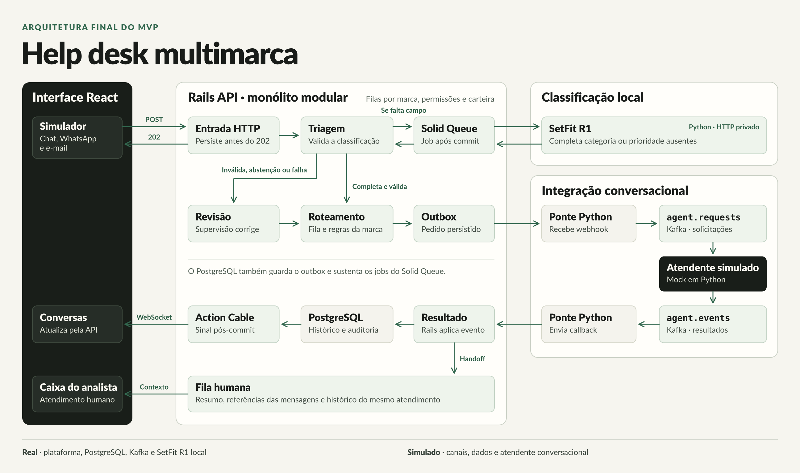

# Help desk multimarca

MVP do TAPI Inteli/CloudWalk. A plataforma recebe atendimentos sintéticos de
Chat, WhatsApp e E-mail, organiza filas por marca, complementa classificações
incompletas com SetFit R1 e encaminha casos ao atendente simulado ou a um
analista humano. Supervisores configuram filas, equipes e regras, e consultam
as decisões registradas.

**Entrega do MVP e piloto E01 concluídos em 26/11/2026.** Os testes de carga
registraram limites na recuperação após interrupção do Kafka e na escala do
chat. Veja [estado, evidências e próximos passos](docs/estado-entrega.md).

## Arquitetura



O monólito modular em Rails controla atendimentos, permissões, filas e
auditoria. A API confirma a entrada após gravá-la no PostgreSQL. O outbox
grava os pedidos de atendimento na mesma transação que abre a rodada. Solid
Queue executa os jobs internos. A ponte Python publica pedidos no Kafka e
devolve as respostas do atendente simulado ao Rails. O Action Cable sinaliza
as mudanças ao React após a gravação.

Uma classificação válida segue ao atendente simulado. Se categoria ou
prioridade estiver ausente, o Rails agenda o complemento pelo serviço SetFit
local. O fluxo preserva campos válidos do canal e encaminha classificações
inválidas ou incertas para a supervisão.

## Rodar a demonstração

Use Python 3.10+ e Docker com Compose 2.24.4+. Na primeira execução, o Compose
baixa e constrói as imagens. Rode na raiz do repositório.

```sh
python3 script/demo.py up
python3 script/demo.py check
```

Abra o [simulador](http://127.0.0.1:45179/) ou a
[área de operação](http://127.0.0.1:45179/analista). Obtenha a senha do
supervisor no terminal.

```sh
python3 script/demo.py login supervisor@example.test
```

O comando `check` envia turnos sintéticos e verifica a reentrega pelo fluxo
Rails/Kafka. Para ver serviços, consultar logs ou encerrar a demonstração:

```sh
python3 script/demo.py status
python3 script/demo.py logs api worker outbox events mock
python3 script/demo.py down
```

O padrão usa classificação fixture e dados fictícios. Para instalar e executar
o pacote SetFit R1, siga o [guia de reprodução local](docs/c07.md). Para
desenvolvimento, consulte [frontend](frontend/README.md),
[contratos](docs/contratos/README.md) e [plano de execução](docs/planejamento/plano-de-execucao.md).

## Resultados e limites

- **Carga.** 208 turnos aceitos expiraram nas rodadas com parada do Kafka.
  O teste de chat confirmou 486 conexões no alvo de
  mil. Veja [resultados e reprodução da F08](docs/f08.md).
- **Atendimento.** O piloto E01 testou Luna com conhecimento sintético por
  marca em ambiente isolado. A demonstração usa o atendente simulado.
- **Publicação.** A URL é temporária e depende do computador e do túnel
  ativos. O projeto usa canais simulados e dados fictícios.

Consulte o [estado detalhado da entrega](docs/estado-entrega.md), a
[especificação](docs/planejamento/especificacao-mvp.md), as
[decisões](docs/planejamento/decisoes.md) e as
[evidências do piloto E01](docs/evidencias/e01/README.md).
