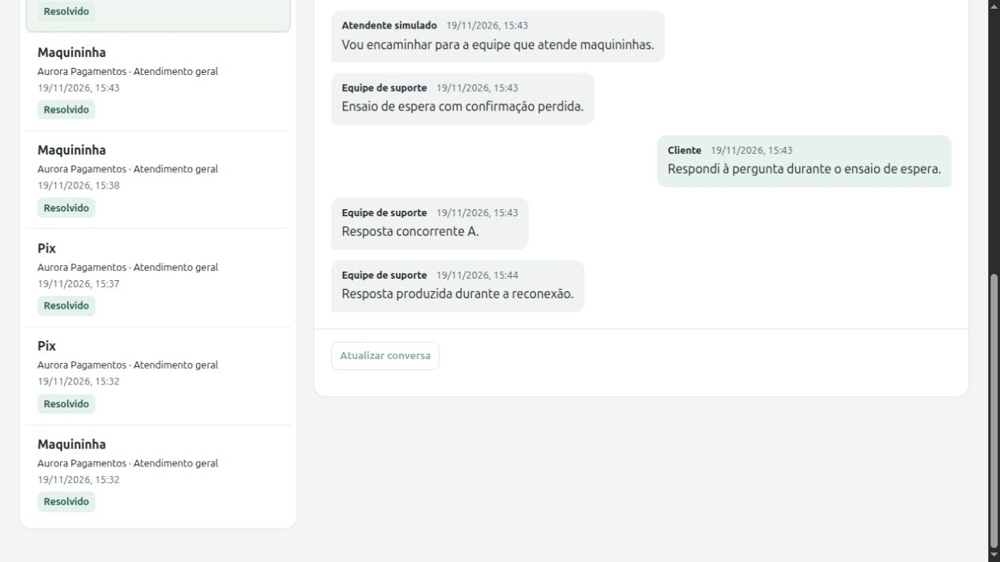

# Integração F04/F05 · API e interface

Verificação central em 2026-11-19, sobre `e1b97d9`, na branch
`feat/integracao-f04-f05-api`, worktree `.worktrees/integracao-f04-f05-api`.
Foram preservados os cinco commits F04 até `5feaee9` e os três commits F05
até `682796f`, unidos em `fbaedfc`. A revisão gerou as correções
`b7d02e8` (frontend), `74370c4` (backend) e `d6ef246` (vínculo da tentativa
à identidade sintética). A revisão final e a reavaliação aprovaram o conjunto.
A integração é local; não houve push.

## Resultado e limites

O simulador usa a API real por padrão e as fixtures somente por escolha
explícita. Os três canais funcionam entre Aurora e Horizonte. A caixa do
analista recebe o handoff com resumo e referências e permite responder,
aguardar, retomar e resolver. O Jev fixture completa campos ausentes por
Solid Queue; o atendente simulado continua passando pelo Kafka.

O código local da F04 e a conexão F05 foram verificados. O aceite da chamada
Jev real continua pendente: `TYPESAFE_API_KEY` não estava presente. As fixtures
não demonstram acerto, latência ou disponibilidade do fornecedor. Configuração
administrativa é F06; robustez completa, carga, avaliação e publicação
continuam em F07–F10. Não foi realizado teste com dez mil usuários.

## Verificações executadas

| Verificação | Resultado observado |
| --- | --- |
| Rails no Ruby 3.4.12 / Rails 8.1.4.1 / PostgreSQL 17 | 74 testes, 881 asserções, zero falhas/erros; um teste Jev ao vivo pulado. Inclui concorrência, classificação tardia, CSRF e isolamento. |
| Contratos e carregamento | 45 fixtures com o resultado esperado, OpenAPI e Zeitwerk aprovados. |
| Regressões F02/F03 reais | Scripts `check_f02.py` e `check_f03.py` passaram novamente após a correção dos digests: dois turnos IA e fluxo humano com replay estável. |
| Troca de identidade durante reenvio | HTTP real: recibo estável em A; logout, login operacional e criação de B; confirmação com expectativa A retornou 409 e manteve zero casos em B. UUID inválido retornou 422. O adaptador React tem regressão de 502, 401 e renovação sem trocar a identidade da tentativa. |
| Python com dependências Kafka instaladas | 10 testes aprovados, incluindo os dois que faltavam nos relatos das frentes. |
| Frontend pelo lockfile | `npm ci` passou no Node 22.23.5; React 19.3.1 e Vite 8.3.8. Os 20 testes e o build TypeScript/Vite passaram. |
| Cable PostgreSQL real | `backend/script/check_case_updates.rb`: avisos da API e de um worker separado, isolamento REST/audiência e ausência de aviso após logout. |
| Upgrade com dados | Schema `e1b97d9` para migrations 3/4 preservou usuários, mensagem e auditoria; criou um pedido para um caso pendente e classificou uma vez. Migrations 5/6 preservaram digest legado do navegador, corrigiram SHA-256 canônico e encerraram tentativa aberta de pedido concluído. O replay canônico preservou o recibo. |
| Navegador com API real | Três canais e duas marcas, recuperação por recarga, handoff e referência, resposta, espera/retomada, resolução e recusa do caso Horizonte para Bia, autorizada somente em Aurora. |
| Respostas perdidas | Um proxy de ensaio devolveu 502 somente depois da resposta Rails. Confirmação do cliente após resolução reutilizou o recibo sem mensagem/caso duplicado. Confirmação de espera após retorno do cliente não reaplicou a espera e mostrou aviso explícito. |
| Conflito real na interface | Duas abas enviaram respostas com a mesma versão: um efeito persistido e um `409`, mantendo o rascunho da aba recusada. |
| Reconexão real | API parada, resposta humana persistida por serviço em outro processo e API reiniciada. A tela mostrou indisponibilidade e recuperou automaticamente a mensagem e a assinatura do caso; o rascunho permaneceu. |

A preparação de desenvolvimento e teste foi inicialmente disparada em paralelo
e interferiu no schema. O banco descartável foi recriado e a preparação
repetida em série antes dos resultados acima. Não preparar esses bancos
simultaneamente. Alterações de formatação geradas nos schemas foram descartadas;
as migrations e os campos entregues foram preservados.

## Correções da revisão

- O proxy preserva o Host do navegador para a validação de origem CSRF.
  O cliente recupera `csrf_rejected` uma vez com a mesma conta, corpo e chave.
- O catálogo do cliente exige `audience=simulator`, sem fallback para staff
  quando a identidade sintética expira. O contrato registra essa extensão.
- Espera fica bloqueada durante troca pendente de marca. Conflitos de versão
  e demais rejeições têm mensagens distintas.
- Envios ambíguos guardam a tentativa original e oferecem confirmação
  explícita. O estado atualizado do caso não cria outra chave automaticamente.
- O backend conserva hashes distintos do corpo canônico e do pedido do
  navegador. Reentrega canônica e reentrega do navegador continuam idempotentes.
- Correção humana finaliza a tentativa invalidada e conserva evidência tardia.
  Uma correção inédita de caso resolvido retorna conflito, com replay autorizado
  de recibos anteriores preservado.
- Cada tentativa de envio do React guarda a identidade sintética de origem.
  `X-Simulator-Session-Id` informa essa expectativa no POST; o Rails verifica
  o cliente autenticado antes de gravar. Troca de sessão retorna
  `409 simulator_session_changed`, e a confirmação não vira outro pedido.
  O header é opcional para clientes legados e obrigatório no fluxo React.

Os ensaios completos no navegador usaram `74370c4` com o frontend `b7d02e8`.
A guarda acrescentada em `d6ef246` foi validada no adaptador React, na suíte
Rails e por HTTP real com cookies e sessões distintas. Não foi repetido todo
o roteiro visual depois dessa alteração no protocolo.

## Reproduzir

Use um projeto Compose exclusivo. Prepare desenvolvimento primeiro e depois
prepare teste, em série. Para a suíte e os contratos:

```sh
rtk docker compose -p cloudwalk_f04f05_check up --build -d db_setup
rtk docker compose -p cloudwalk_f04f05_check wait db_setup
rtk docker compose -p cloudwalk_f04f05_check run --rm --no-deps -e RAILS_ENV=test db_setup bundle exec rails db:prepare test
rtk docker compose -p cloudwalk_f04f05_check run --rm --no-deps db_setup bundle exec rails zeitwerk:check
rtk docker compose -p cloudwalk_f04f05_check run --rm --no-deps db_setup bundle exec ruby /workspace/script/check_contracts.rb
rtk docker compose -p cloudwalk_f04f05_check run --build --rm --no-deps web npm test
rtk docker compose -p cloudwalk_f04f05_check run --rm --no-deps web npm run build
```

O [roteiro F04](f04.md) executa o teste Cable em pilha sem worker ativo, pois
o próprio ensaio inicia e encerra seu worker. O [roteiro F03](f03.md) fornece
as credenciais sintéticas, a ponte, o mock e o outbox para a demonstração
completa. Nessa pilha configure o worker com `CLOUDWALK_JEV_MODE=fixture`,
suba o frontend e siga o [aceite da interface](../frontend/README.md).
O teste com o fornecedor real usa o comando explícito de F04 e a chave no
ambiente; não imprima nem versione a credencial.

Os cenários adicionais de perda de resposta e os upgrades com dados usaram
um proxy e runners temporários desta revisão. Não fazem parte do `npm test`
nem são uma suíte de navegador portátil. Para repetir a exploração, faça o
proxy devolver falha após receber o sucesso Rails e siga a confirmação
explicada no README do frontend. A automação portátil desses cenários fica
com a bateria de robustez F07.

## IDs da demonstração no navegador

| Cenário | Atendimento |
| --- | --- |
| Chat Aurora, categoria ausente, complemento fixture e resolução IA | `82439f86-0b89-4772-b477-cbfde9b4e6c5` |
| WhatsApp Aurora, handoff, espera/retomada e resolução humana | `761fa052-34f2-43e9-add4-0f55e156b017` |
| E-mail Horizonte, resposta e recarga | `f42c0b7f-bba6-45e9-8cf2-5f5a742e1ae8` |
| Confirmação do cliente após resolução sem duplicar | `823e182d-1296-4c8a-8041-eae30e22dc0a` |
| Espera ambígua, duas abas em conflito e reconexão | `066d2d3e-c493-4706-a807-c01c962cd802` |

Os IDs identificam a execução descartável, encerrada após o aceite; não são
fixtures fixas nem atendimentos que existirão em outra instalação.



Exercício: em um caso humano, preveja o que ocorre com duas respostas usando
a mesma versão. Execute o envio em duas abas e confira que só uma mensagem
entrou, enquanto o outro rascunho permaneceu para revisão.
