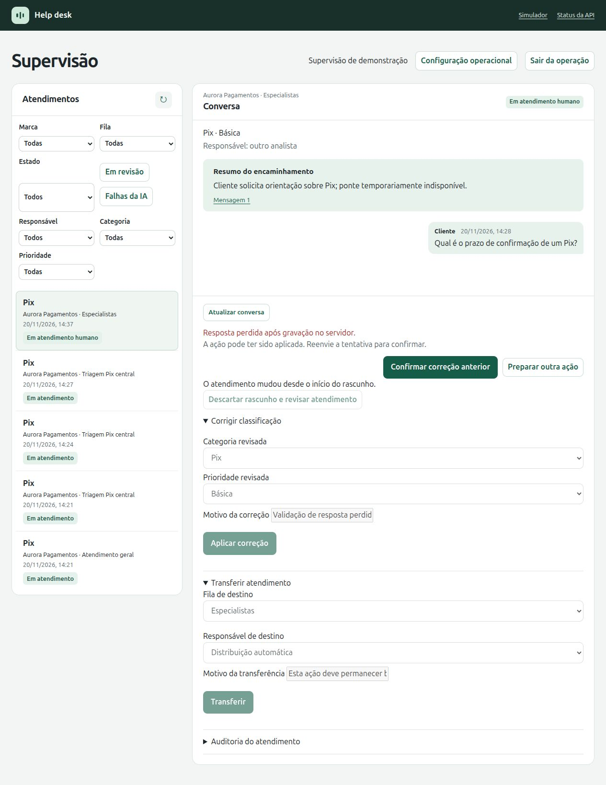
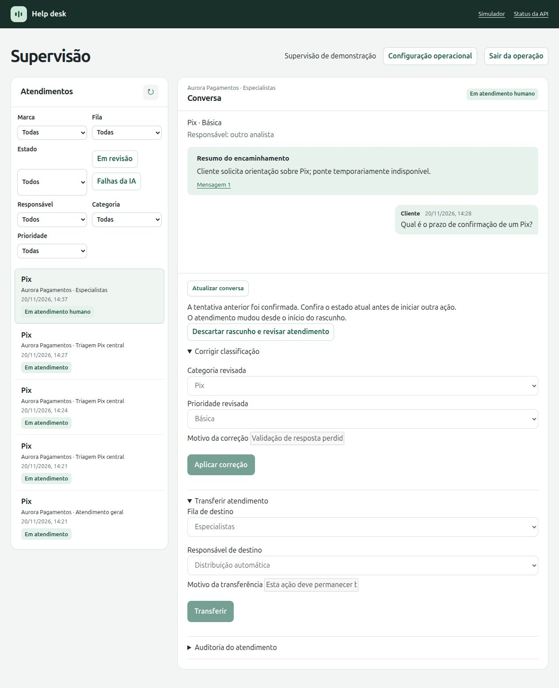

# Integração F06/F07-A — 2026-11-20

A F06 e a F07-A foram verificadas juntas sobre `2b17a2f`, na branch
`feat/integracao-f06-f07`. O código validado está em `fbc2192`.
As worktrees das duas frentes e seus históricos foram preservados. A entrega
original da F06 foi registrada em `06ee854` e a da F07-A em `bc2b502`.
Os impedimentos de Git, Docker e instalação de dependências relatados pelos
outros chats foram superados no ambiente de integração. Não houve push.

## Resultado verificável

| Verificação executada | Resultado |
| --- | --- |
| Rails 8.1.4.1, Ruby 3.4.12, PostgreSQL 17 | 86 testes, 1.065 asserções, zero falhas e erros. Uma omissão: chamada real TypeSafe sem chave. |
| Concorrência administrativa | Duas conexões disputam revogação versus atribuição e publicação de regra versus classificação inicial. Ambas passaram no PostgreSQL real. |
| Migração de atualização | Aplicação sobre o schema de `2b17a2f`, em banco separado, preservou usuários, caso, fila, mensagem e auditoria já existentes. |
| Contratos e carregamento Rails | OpenAPI 3.1, JSON Schema 2020-12, 47 fixtures (uma inválida esperada) e Zeitwerk aprovados. |
| Frontend | Instalação com `npm ci`, 24 testes, checagem TypeScript e build Vite aprovados no Node 22 da imagem do projeto. Inclui o proxy HTTP real. |
| Ponte e mock | 10 testes aprovados com as dependências da imagem, incluindo `confluent_kafka`. |
| Verificador F07-A | 12 testes isolados aprovados. |
| Kafka, HTTP, SQL e WebSocket reais | Cinco cenários aprovados em duas rodadas: `c7239cd` e `fbc2192`. A pilha isolada foi removida ao final de cada rodada. |

O [relatório JSON final](evidencias/f07-a-2026-11-20.json) registra o resultado
por cenário e as evidências observadas. No cenário 05, o ACK de publicação
foi retido: o registro de falha já estava no log, o offset de entrada ainda
estava pendente e não houve commit antecipado. Só depois de liberar o ACK
foi observado o commit. O roteiro e os limites das janelas estão na [F07-A](f07.md).

## Aceite da supervisão no navegador

O ensaio usou apenas identidades e dados sintéticos em uma pilha local própria.

1. Criou a fila **Triagem Pix central** com duas equipes da Aurora e uma regra
   Pix de posição 10. O caso anterior conservou a fila padrão; o seguinte
   entrou na nova fila com regra e versão registradas na auditoria.
2. Publicou a categoria **Contestação**, observou-a no simulador e publicou
   uma alternativa de capacidade para Bia. Conferiu as versões na auditoria.
3. Enviou um texto que levou o Jev fixture à revisão. A correção do supervisor
   aplicou o roteamento inicial e o agente respondeu através do Kafka real.
4. Interrompeu a ponte de pedidos. Após esgotar as tentativas, a supervisão
   recuperou um caso com **Tentar IA novamente** e encaminhou outro a humano,
   com resumo e referência à mensagem original.
5. Editou um rascunho de transferência enquanto outra janela transferia o
   caso. A atualização bloqueou o rascunho antigo até revisão explícita.
6. Substituiu a resposta HTTP de uma correção já gravada por `502`. Com duas
   ações abertas, os demais comandos ficaram bloqueados. **Confirmar correção
   anterior** reutilizou a tentativa original e retornou a confirmação.

Casos usados para localizar a trilha na sessão de ensaio:

| Evidência | Caso |
| --- | --- |
| Antes da regra | `a2170a44-ecc8-4244-81ca-5d22361a9c93` |
| Depois da regra | `3a495aa0-ab42-4ba6-8c1b-933411b301e7` |
| Correção da revisão | `4b7aa134-c28e-4e84-bfc6-d4711d286f5d` |
| Recuperação da IA | `77d03d20-84a4-4c04-82b6-14b1183faab2` |
| Handoff, conflito e confirmação | `70375bba-7a75-4a17-91ae-26e985478c1d` |

Esses IDs pertencem ao banco descartável do ensaio; a reprodução gera outros.

## Correções e decisões da revisão

As correções da F06 estão em `abf0823`, `0263e2c`, `1f2dc1a` e `6b6da41`.
O perfil de um analista exige autorização sobre seu conteúdo inteiro. Quando
um vínculo removido deixa uma categoria fora do escopo, leitura e publicação
retornam `403`. Isso evita revelar ou sobrescrever alternativas ocultas;
a regularização de um perfil legado pode exigir um supervisor mais abrangente.

A auditoria usa o escopo comprovado na publicação. Uma mudança posterior do
catálogo não revela alternativas que pertenciam a outra marca. Eventos antigos
sem essa comprovação omitem `alternatives` na resposta e conservam os demais
campos. O registro armazenado permanece íntegro; o custo é perder esse detalhe
na visualização de históricos sem proveniência suficiente.

A F07-A foi corrigida em `c7239cd`: preparação e volumes do writer/outbox,
chamada do SDK, controle do ACK, janela de revogação e diagnóstico do runner.
O primeiro resultado parcial foi usado para reproduzir falhas, sem contá-lo
como aceite. As duas rodadas posteriores aprovaram todos os cenários.

## Reprodução e limites

Os comandos estão nos roteiros [F06](f06.md) e [F07-A](f07.md). Prepare os
bancos de desenvolvimento e teste em sequência. Use projetos Compose próprios
e as versões dos Dockerfiles; o Ruby do host não é o runtime do projeto.
O verificador recusa recursos preexistentes e não publica portas da pilha.

Ainda falta a chamada TypeSafe real com `TYPESAFE_API_KEY` e a avaliação
da qualidade do classificador. Fixture não mede precisão nem latência do
fornecedor. O atendente via Kafka continua sendo o mock previsto no escopo.

A F07-A não contém a matriz externa de revogação administrativa da F06; os
testes Rails cobrem autorização e reconciliação e as duas corridas usam o
PostgreSQL real. O fechamento dessa matriz deve registrar também uma sessão
WebSocket aberta durante a revogação administrativa. O teste de carga, o
experimento de 10 mil usuários e a publicação seguem nas próximas entregas.

Como limitações dos ensaios, a janela sem avisos no cenário 04 é finita;
o runner pode diagnosticar bloqueio em preparação muito lenta; o encerramento
das threads dos testes de corrida pode exceder o prazo se outra sessão mantiver
um bloqueio indefinidamente. Nenhum desses limites constitui evidência de SLA
ou de capacidade de produção.

Exercício: localize no JSON `ack_held`, `offset_while_ack_held` e
`ack_after_commit`. Explique por que o commit precisa vir depois do ACK.
Depois publique duas regras de Pix e compare o histórico dos casos novos.
