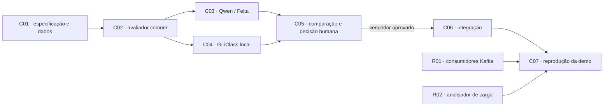

# CLASS-001 — construir, comparar e selecionar o classificador

Estado: cards completos para revisão da divisão e publicação. Nenhuma tarefa
de modelo foi implementada ou executada como parte deste planejamento.

[Especificação CLASS-SPEC-001](especificacao.md) · [Guia para os chats](guia-dos-chats.md).

## Decisões e limites

Está confirmado comparar Qwen pela Feita com GLiClass local. Ainda precisam
ser aprovados em C01 os rótulos, a separação de dados, os limites de aceitação
e o orçamento real. A integração operacional só começa depois de C05 registrar
um vencedor elegível aprovado pelo responsável. O resultado pode ser inconclusivo.

Os cards representam Specification Driven Development. Cada tarefa deve ligar
comportamento especificado, critérios de aceite, evidências e decisão de revisão.
Um commit ou teste fixture, sozinho, não equivale a aceite com um modelo real.

## Cards e dependências

| ID | Entrega verificável / história | Bloqueado por | Onde trabalhar | Modelo sugerido |
| --- | --- | --- | --- | --- |
| [C01](cards/C01-protocolo.md) | Responsável aprova protocolo, dados e limites antes de gastar ou medir. | Decisões humanas do chat central. | Aqui, junto do responsável. | Chat central; Astra para revisar o desenho. |
| [C02](cards/C02-avaliador.md) | Avaliador recebe lote fixture e produz relatório comum validado. | C01 aprovado/integrado. | Chat de avaliador. | GPT-6.2 Astra, alto. |
| [C03](cards/C03-qwen.md) | Relato de desenvolvimento percorre Feita/Qwen e o relatório comum. | C02; piloto real também exige gates de C01. | Chat Qwen, em paralelo com C04. | GPT-6.2 Sol, alto. |
| [C04](cards/C04-gliclass.md) | Relato percorre inferência local e relatório com tempos/recursos. | C02 e dados de desenvolvimento aprovados. | Chat GLiClass, em paralelo com C03. | GPT-6.2 Sol, alto. |
| [C05](cards/C05-decisao.md) | Responsável compara evidências reais e registra vencedor ou inconclusão. | C03/C04 aceitos; dados/orçamento liberados. | Aqui, com execução coordenada. | Chat central; Astra para análise. |
| [C06](cards/C06-integracao.md) | Atendimento usa o escolhido e chega à resposta ou à revisão corretamente. | C05 com vencedor aprovado e contrato congelado. | Chat de integração, revisão aqui. | GPT-6.2 Astra, alto. |
| [C07](cards/C07-reproducao.md) | Avaliador reproduz a demo e entende escolha/limites seguindo o guia. | C06, R01 e R02 integrados e aceitos. | Chat de reprodução, aceite aqui. | GPT-6.2 Sol, alto. |
| [R01](cards/R01-recuperacao.md) | Consumo se recupera da perda de associação Kafka com efeitos idempotentes. | Independente dos cards de classificação. | Chat de robustez. | GPT-6.2 Astra, alto. |
| [R02](cards/R02-analisador.md) | Analisador preserva provas de atraso e atribui escrita ambígua de chat. | Independente dos cards de classificação. | Chat de análise de carga. | GPT-6.2 Astra, alto. |

## Como usar este quadro

1. Começar por C01 neste chat. Modelos e integração não começam antes do
   protocolo comum; as duas correções R01/R02 podem andar independentemente.
2. O integrador fornece o SHA que contém a especificação e as dependências
   integradas, e prepara/confere branch e worktree antes de cada delegação.
3. Abrir C03 e C04 em paralelo somente depois de C02. Implementação pode ser
   paralela; medições de CPU/RAM/carga no mesmo host devem ser coordenadas.
4. Trazer commits, resultados e bloqueios ao chat central. O responsável faz
   o exercício e aprova as decisões de dados/modelo. Somente então liberar o card seguinte.
5. Um card não fica concluído só porque o código foi escrito. Registrar quais
   aceites passaram, quais ficaram bloqueados e em qual ambiente/revisão.

## GitHub e base de execução

Tracker identificado: `leeunam/case-CLOUDWALK-IA`. Na consulta de 2026-11-23,
o repositório remoto estava sem código e sem issues. A base de aplicação local
estudada é `cb9683179d713e7bcbfc95c54003dc30630ab7ad`, na `main`.

Essa referência não substitui o SHA de início de uma tarefa: o integrador deve
informar um commit que já contenha esta especificação e as dependências do card.
Não pedir a um agente que consuma mudanças não commitadas de outra worktree.
Um agente remoto precisa do código acessível no seu ambiente antes de começar;
criar issues não publica automaticamente o código. Publicação do código é uma
ação própria e não foi incluída neste planejamento.

As issues podem ser publicadas após revisão da divisão e das dependências.
O épico conterá a especificação para que sua leitura não dependa de links para
arquivos ainda ausentes no GitHub. `issue-manifest.json` enumera títulos,
dependências e labels existentes; o mapa de URLs será preenchido na publicação.

## Saída da frente

Um modelo selecionado com evidência e integração verificável, ou uma decisão
fundamentada de que os candidatos ainda não atendem aos critérios. A seleção
não inclui treinamento, UI para escolher modelos, fallback entre fornecedores,
novos canais reais ou alegação de capacidade de produção.

F10/publicação por URL e cenários de escala continuam tarefas próprias. Os
resultados históricos F08 permanecem publicados com cinco aprovações, uma
reprovação de recuperação e uma tentativa extra bloqueada.
