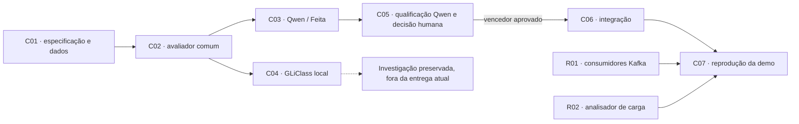

# CLASS-001 — avaliar e selecionar o classificador

Estado: nove cards e o [épico #1](https://github.com/leeunam/case-CLOUDWALK-IA/issues/1) publicados em 2026-11-23,
com divisão aprovada pelo responsável. A publicação inicial dos cards não
executou modelos; as implementações e medições posteriores estão registradas abaixo.

[Especificação CLASS-SPEC-001](especificacao.md) · [Guia para os chats](guia-dos-chats.md).

## Situação atual — proposta SF2, 25/11/2026

Após o piloto SetFit e o aceite externo F10 em fixture, o responsável retomou
a classificação. Foram aprovados 360 relatos novos: 150 de treino, 90 de
validação e 120 finais. A [especificação SF2](sf2/especificacao.md), o
[protocolo declarativo](sf2/protocolo.json) e a [divisão dos agentes](sf2/tarefas.md)
estão preparados para revisão antes da execução. Dois especialistas, regra de
revisão e quotas internas são propostas; nenhum modelo SF2 foi treinado/adotado.
C06/C07 continuam condicionadas à qualificação e adoção, sem novas chamadas pagas.

## Histórico de decisões e limites

Após investigar Qwen pela Feita e GLiClass local, o responsável aprovou
focar na qualificação do Qwen e encerrar novos ajustes do GLiClass nesta
entrega. C04 conserva seus resultados e deixa de bloquear C05. Não houve
comparação pareada final nem escolha de modelo. [Plano vigente](qualificacao-qwen.md).
Os 60 rótulos
foram revisados para referência exploratória: oito casos diretamente pelo
responsável e 52 pela IA sob delegação, conforme o [registro](revisao-de-rotulos.md).
A separação de dados e os limites de aceitação foram aprovados; contratos
v1.1.0 passaram na verificação local. O piloto Qwen recebeu teto de US$ 10,
com orientação de minimizar requisições; consumiu uma chamada. O escopo
financeiro do teste final foi definido e autorizado posteriormente, sob o mesmo
teto cumulativo. O lote de 24/11/2026 concluiu 36 relatos + 13 controles em 44
chamadas, por US$ 0,02197127. Resultado técnico **não elegível**: 3/7 conclusões
indevidas e 19/22 categorias aplicadas corretas. O p95 de 2.493,510 ms e o
reconhecimento de 6/6 urgentes passaram. C05 aguarda deliberação humana e C06
continua bloqueada. [Resultado e auditorias](../../c05-resultado.md).
A integração operacional só começa depois de C05 registrar
um vencedor elegível aprovado pelo responsável. O resultado pode ser inconclusivo.

Os cards representam Specification Driven Development. Cada tarefa deve ligar
comportamento especificado, critérios de aceite, evidências e decisão de revisão.
Um commit ou teste fixture, sozinho, não equivale a aceite com um modelo real.

Os [critérios e a separação dos dados](protocolo-comparacao.md) foram aprovados
na C01. O [aceite](aceite-c01.md) registra contratos, verificações e limites
com C02 aceita após revisão e reprodução. A C03 tem implementação e piloto
real mínimo aceitos, com uma chamada e cobrança de aproximadamente US$ 0,000518. A C04 tem código
revisado e investigação local preservada, com falhas de latência e um
rebaixamento de urgência. Sua configuração não está aprovada para C05.
A [passagem atual](passagem-autonoma.md) identifica a próxima decisão humana.

C01-L/C02-L estão aceitas e integradas em `933836e`: as próximas avaliações
selecionam `--profile observed-total-1.1`, com p95 do tempo total da classificação
até 3.000 ms. O relatório 1.2 preserva o IPC 1.1. Passaram 39 testes C02;
os 17 relatórios históricos conservaram seus hashes. A atualização não fez
novas inferências. [Plano, aceites e limites](plano-latencia-total.md).

## Cards e dependências

| ID | Entrega verificável / história | Bloqueado por | Onde trabalhar | Modelo sugerido |
| --- | --- | --- | --- | --- |
| [C01 — #2](https://github.com/leeunam/case-CLOUDWALK-IA/issues/2) | Responsável aprova protocolo, dados e limites antes de gastar ou medir. | Decisões humanas do chat central. | Aqui, junto do responsável. | Chat central; Astra para revisar o desenho. |
| [C02 — #3](https://github.com/leeunam/case-CLOUDWALK-IA/issues/3) | Avaliador recebe lote fixture e produz relatório comum validado. | C01 aprovado/integrado. | Chat de avaliador. | GPT-6.2 Astra, alto. |
| [C03 — #4](https://github.com/leeunam/case-CLOUDWALK-IA/issues/4) | Relato de desenvolvimento percorre Feita/Qwen e o relatório comum. | C02; piloto real também exige gates de C01. | Chat Qwen, em paralelo com C04. | GPT-6.2 Sol, alto. |
| [C04 — #5](https://github.com/leeunam/case-CLOUDWALK-IA/issues/5) | Investigação encerrada nesta entrega; evidências e limitações preservadas, sem aceite do modelo. | Não bloqueia C05. | Arquivo da investigação GLiClass. | Sem novas inferências. |
| [C05 — #6](https://github.com/leeunam/case-CLOUDWALK-IA/issues/6) | Qualificar Qwen contra as metas e registrar elegibilidade, reprovação ou inconclusão. | C03/C02 aceitas; disponibilidade e execução verificadas. | Aqui, com execução coordenada. | Chat central; Astra para análise. |
| [C06 — #7](https://github.com/leeunam/case-CLOUDWALK-IA/issues/7) | Atendimento usa o escolhido e chega à resposta ou à revisão corretamente. | C05 com vencedor aprovado e contrato congelado. | Chat de integração, revisão aqui. | GPT-6.2 Astra, alto. |
| [C07 — #10](https://github.com/leeunam/case-CLOUDWALK-IA/issues/10) | Avaliador reproduz a demo e entende escolha/limites seguindo o guia. | C06, R01 e R02 integrados e aceitos. | Chat de reprodução, aceite aqui. | GPT-6.2 Sol, alto. |
| [R01 — #8](https://github.com/leeunam/case-CLOUDWALK-IA/issues/8) | Consumo se recupera da perda de associação Kafka com efeitos idempotentes. | Independente dos cards de classificação. | Chat de robustez. | GPT-6.2 Astra, alto. |
| [R02 — #9](https://github.com/leeunam/case-CLOUDWALK-IA/issues/9) | Analisador preserva provas de atraso e atribui escrita ambígua de chat. | Independente dos cards de classificação. | Chat de análise de carga. | GPT-6.2 Astra, alto. |

## Como usar este quadro

1. Começar por C01 neste chat. Modelos e integração não começam antes do
   protocolo comum; as duas correções R01/R02 podem andar independentemente.
2. O integrador fornece o SHA que contém a especificação e as dependências
   integradas, e prepara/confere branch e worktree antes de cada delegação.
3. Abrir C03 e C04 em paralelo somente depois de C02. Implementação pode ser
   paralela; medições de CPU/RAM/carga no mesmo host devem ser coordenadas.
4. Trazer commits, resultados e bloqueios ao chat central. O responsável faz
   o exercício e aprova as decisões de dados/modelo. Somente então liberar o card seguinte.
5. Um card não fica concluído só porque o código foi escrito. Registrar quais
   aceites passaram, quais ficaram bloqueados e em qual ambiente/revisão.

## GitHub e base de execução

Tracker identificado: `leeunam/case-CLOUDWALK-IA`. Na consulta anterior à publicação de 2026-11-23,
o repositório remoto estava sem código e sem issues. Os cards foram publicados;
a publicação do código não foi executada nesta ação. A base de aplicação local
estudada é `cb9683179d713e7bcbfc95c54003dc30630ab7ad`, na `main`.

Essa referência não substitui o SHA de início de uma tarefa: o integrador deve
informar um commit que já contenha esta especificação e as dependências do card.
Não pedir a um agente que consuma mudanças não commitadas de outra worktree.
Um agente remoto precisa do código acessível no seu ambiente antes de começar;
criar issues não publica automaticamente o código. Publicação do código é uma
ação própria e não foi incluída neste planejamento.

A divisão e as dependências foram aprovadas antes da publicação. O épico
incorpora a especificação e o guia de passagem, para que sua leitura não dependa
de arquivos ainda ausentes no GitHub. `issue-manifest.json` registra números,
URLs, dependências, labels e o estado inicial dos nove cards. O progresso atual
deve ser consultado nas issues, sem tratar essa fotografia como estado vivo.

## Saída da frente

Um modelo selecionado com evidência e integração verificável, ou uma decisão
fundamentada de que os candidatos ainda não atendem aos critérios. A seleção
não inclui treinamento, UI para escolher modelos, fallback entre fornecedores,
novos canais reais ou alegação de capacidade de produção.

F10/publicação por URL e cenários de escala continuam tarefas próprias. Os
resultados históricos F08 permanecem publicados com cinco aprovações, uma
reprovação de recuperação e uma tentativa extra bloqueada.

## Passagem aceita do avaliador

C02 integrada localmente em `d8e09b62e42122e08e3c8edc7f3566dcdb82a173`.
[Relatório e interface](../../c02.md): 27 testes no aceite inicial e 31 após
a manutenção de integração, com revisões aprovadas,
exemplo do código aceito revalidado pelos schemas e hashes. C03 e C04 recebem
a mesma base imutável com essa integração e trabalham em áreas próprias.
R01 e R02 têm aceite local concluído. Vencedor e orçamento de API seguem pendentes.
