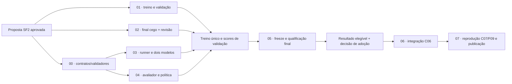

# SF2 — tarefas, dependências e trabalho paralelo

Este plano executa a [especificação aprovada](especificacao.md). O responsável
aprovou a SF2 e liberou a primeira onda 00/01/02 em 25/11/2026:
[registro](aprovacao.json). Treino real continua bloqueado pelos aceites previstos.
Após a conclusão da primeira onda, a continuação autorizou implementar 03/04.
A [interface da segunda onda](interface-onda2.md) fixa o transporte local e a
separação entre supervisão do treino e execução do ensaio.
O integrador prepara branches/worktrees antes de cada passagem.

## Contrato de trabalho de todos os agentes

Ler AGENTS.md, CONTEXT.md, este plano, a especificação e protocolo SF2. Usar RTK.
O integrador entrega um **SHA concreto integrado**, branch e worktree; não usar
HEAD móvel ou mudanças não commitadas de outra frente. Ao retomar, conferir e
reutilizar a worktree atribuída. Preservar PDF e mudanças locais alheias.

Não chamar APIs do classificador, ler `.env`/chaves/contabilidade, publicar,
alterar a demonstração ou abrir trabalho além do card. Nenhum agente de treino
ou política pode ler o final reservado, incluindo outros diretórios privados.
Não delegar subagentes por conta própria: o integrador atribui revisores e
anotadores independentes. Commit em português Conventional Commits, arquivos
explícitos, sem push. Cada retorno traz base/head, testes reais, limitações,
passos de reprodução e um exercício curto.

Modelos abaixo são recomendações para os **agentes de desenvolvimento**;
o classificador do produto será SetFit, se qualificado. Rótulos produzidos por
agentes da mesma família podem ter erros correlacionados; registrar essa limitação.

## Ondas de execução

00, autoria de 01 e autoria de 02 podem começar na mesma base de planejamento
aprovada. Os autores consomem o formato de registro especificado, não alterações
em curso no código de 00. O aceite e os selos dos dados esperam o validador 00
integrado. Depois, 03 e 04 podem implementar com fixtures na base integrada
de 00, enquanto os dados são revisados. **Treino real espera 00–04 aceitas e
ambos os conjuntos públicos e final selados.** O desenho não permite selecionar
limiares enquanto outro autor ainda altera os dados finais.

Código pode ser feito em paralelo. Instalações pesadas, treino dos dois
especialistas e medições de CPU/latência são coordenados e sequenciais no
mesmo computador. Não rodar F08/carga ou outro treino durante as medições.
No chat central, respeitar o número de agentes simultâneos disponível.

## Cards executáveis

### SF2-00 — contratos e validadores de pesquisa

- **Agente:** GPT-6.2 Astra, alto. **Base:** commit de planejamento aprovado,
  fornecido em SHA pelo integrador.
- **Branch/worktree:** `feat/sf2-contratos` · `.worktrees/sf2-contratos`.
- **Possui:** `docs/planejamento/classificacao-comparativa/sf2/contratos/`,
  `script/classification_comparison/setfit_sf2/contracts/` e testes desse módulo.
- **Entrega:** schemas de relato/anotação/manifestos, entrada/decisão experimental,
  pacote de scores, política, congelamento e relatório; validador das quotas,
  máscaras, gold/canal, suporte, hashes e integridade. Fixtures positivas e
  negativas, incluindo parcial injetada, score inválido, campos válidos e erro.
- **Aceite:** contrato `sf2-ipc/1.0` validado sem mudar versões históricas;
  fixtures inválidas são rejeitadas; nenhum peso ou dado reservado necessário.
  Não relaxar parâmetros desta proposta para facilitar implementação.
- **Exercício:** mudar apenas `missing_fields` de uma fixture sem mudar a
  entrada recebida e observar a rejeição da inconsistência.

### SF2-01 — dados públicos de treino e validação

- **Agente:** GPT-6.2 Sol, alto; anotação independente por outro agente fresco,
  atribuída pelo integrador. **Base:** mesmo planejamento de 00.
- **Branch/worktree:** `feat/sf2-dados-publicos` · `.worktrees/sf2-dados-publicos`.
- **Possui:** `docs/planejamento/classificacao-comparativa/sf2/dados/train.jsonl`,
  `validation.jsonl`, `annotations-public.jsonl`, `manifest-public.json`.
- **Entrega:** 150+90 relatos, duas anotações cegas entre si, conciliação,
  família, quotas, comprimentos tokenizados e relatório de limitações.
- **Aceite:** validador 00 integrado; zero desacordo não resolvido; classes e
  13 urgentes-alvo da validação conferidos; novos textos sem reutilizar dados
  históricos. Nenhum treino, escolha de limiar ou acesso aos 120 finais.
- **Exercício:** apontar, em um relato público, a evidência de categoria e a
  falta de informação que impede atribuir prioridade.

### SF2-02 — custodiante do final independente

- **Agente:** GPT-6.2 Sol, alto, diferente dos autores de treino/política;
  anotador independente fresco designado pelo integrador.
  **Base:** planejamento aprovado; aceite espera 00 e 01 integradas.
- **Branch/worktree:** `feat/sf2-dados-finais` · `.worktrees/sf2-dados-finais`.
- **Possui:** somente `final-seal.json` e `final-review-summary.md` na pasta
  pública `docs/planejamento/classificacao-comparativa/sf2/dados/`.
  Textos/gold/anotações ficam **apenas** em
  `/home/inteli/Documents/projetos/case-CLOUDWALK-IA/.superpowers/sdd/conclusao-projeto/sf2-final/`.
- **Entrega:** 120 finais e anotações, revisão de famílias/semelhança com dados
  públicos e históricos, hash do pacote, contagens e recibo sem divulgar casos.
- **Aceite:** 96 classificáveis, 24 revisões, 17 urgentes-alvo, distribuição
  de categorias/prioridades por máscara conforme protocolo; validador 00; zero dúvida
  pendente. Selo anterior ao treino; final não entra no Git antes da avaliação.
- **Exercício:** conferir apenas as contagens e SHA do selo; não abrir textos.

### SF2-03 — runner, artefatos e adaptador local

- **Agente:** GPT-6.2 Sol, alto. **Base:** SHA integrado de 00; execução com
  dados apenas depois de 01/02/04 aceitas.
- **Branch/worktree:** `feat/sf2-treinamento` · `.worktrees/sf2-treinamento`.
- **Possui:** `script/classification_comparison/setfit_sf2/training/`,
  `adapter/`, instalação/supervisão e respectivos testes; não altera contratos,
  dados, avaliador ou tabelas de corte.
- **Entrega de implementação:** instalação com pins SF1 e código para os dois
  treinos fixados, export/reload e manifesto; adaptador que recebe só campos
  necessários, valida catálogo e preserva atomicidade; código de extração única
  de scores de validação. Os modelos reais e scores só serão gerados em 05.
  A interface de saída da política vem de 00 e a escolha dos cortes vem de 04.
- **Aceite de implementação:** instalação/imports e checagem de pins; fixtures
  de preservação/revisão/erro, projeção sem gold e supervisão/interrupção passam.
  O teste de contrato de export/reload usa fixture identificada. Evidência do
  ajuste real do encoder, classes/convergência, reload dos pesos treinados e
  scores reais é aceite de **05**, não pré-requisito para aceitar este código.
  Nenhum texto/gold final é acessado.
- **Exercício:** retirar prioridade da mesma entrada pública e verificar que
  somente seu especialista foi invocado.

### SF2-04 — avaliador independente e seleção da revisão

- **Agente:** GPT-6.2 Astra, alto. **Base:** SHA integrado de 00; pode começar
  com fixtures em paralelo com 03.
- **Branch/worktree:** `feat/sf2-avaliador` · `.worktrees/sf2-avaliador`.
- **Possui:** `script/classification_comparison/setfit_sf2/evaluation/` e testes
  desse módulo. Não altera modelo, rótulos, protocolo ou score original.
- **Entrega:** projeção sem gold, cálculos/denominadores, controles, 225 políticas,
  ordenação fixa, selos, CLI de validação/freeze/execução/auditoria e relatório.
- **Aceite:** fixtures matemáticas independentes demonstram gates separados de
  urgência bruta versus aplicada, revisão integral, zero campo aplicado e
  percentis. Parcial, pacote divergente e ausência de métrica não passam.
  Autoria do avaliador não concede acesso antecipado aos finais.
- **Exercício:** encontrar uma proposta urgente correta que foi vetada porque
  categoria pediu revisão; conferir as duas métricas separadamente.

### SF2-05 — treino coordenado, freeze e qualificação

- **Agente:** integrador neste chat; executor separado do autor da candidata;
  revisão fresca GPT-6.2 Astra, alto. **Base:** SHA com 00–04 aceitas e integradas.
- **Branch/worktree:** `feat/sf2-qualificacao` · `.worktrees/sf2-qualificacao`.
- **Possui:** `docs/evidencias/c05/sf2/qualificacao-01/` e relatório do resultado.
  Se abrir o final, arquiva pacote/anotações e trilha de exposição. Se bloquear
  na validação, publica só selo, desenvolvimento e motivo; final permanece privado.
- **Entrega:** pré-voo e hashes, treino de categoria e prioridade uma vez,
  seleção dos cortes na validação, congelamento e final condicional de 120,
  tempos/recursos, scores, decisões, métricas e parecer de elegibilidade.
- **Aceite:** nenhuma exposição antecipada, zero mudança de corte/peso/gold
  pelo final, 120 resultados/durações reais selados para aprovação e todos os gates.
  O único treino real deve demonstrar ajuste dos encoders, classes/convergência,
  export/reload dos pesos e extração única dos scores que 03 apenas implementou.
  Resultado negativo/inconclusivo também é entrega válida da tarefa, **sem**
  liberar C06. Adoção é decisão registrada do responsável.
- **Exercício:** seguir um caso final, depois da avaliação, do score bruto até
  a decisão e identificar o denominador de cada métrica.

### SF2-06 — integração C06 condicionada

- **Agente:** GPT-6.2 Astra, alto. **Base:** SHA com qualificação completa,
  decisão de adoção e contrato de proveniência integrado pelo chat central.
- **Branch/worktree:** `feat/setfit-classificacao` · `.worktrees/c06-setfit`.
- **Possui:** adaptador/configuração de classificação da aplicação e testes
  correlatos; contratos/tipos/schema compartilhados coordenados antes de uso.
- **Entrega:** pacote local do modelo aprovado acionado pelo job Rails,
  origem SetFit por campo e identificação de modelo/política/hash, correção
  auditada, falha/revisão, catálogo/versão e descarte tardio preservados.
- **Aceite:** zero inferências em entrada completa/inválida, somente alvos
  ausentes, resposta Kafka ou revisão coerentes; reentrega/correção em voo,
  resultado tardio e isolamento de duas marcas. Sem seleção dinâmica/fallback
  nem alteração incidental de webhook/eventos. Forma concreta do processo
  residente é fixada antes de implementar C06, com recursos medidos em SF2.
- **Exercício:** seguir um caso recebido com categoria válida e prioridade
  ausente, identificando fonte de cada campo e autorização do envio ao Kafka.

### SF2-07 — reprodução C07/F09 e atualização da demonstração

- **Agente:** GPT-6.2 Sol, alto; revisão e publicação pelo integrador.
  **Base:** SHA com C06 aceita e dependências integradas.
- **Branch/worktree:** `feat/reproducao-setfit` · `.worktrees/c07-setfit`.
- **Possui:** roteiro, instalação/imagens/configuração necessárias ao modelo
  local, verificadores de reprodução e evidências finais; sem refatoração geral.
- **Entrega:** instalação limpa com artifact verificado, três canais/duas
  marcas, caminho direto/complemento/revisão/correção, Kafka/handoff e restart
  com persistência; README de decisão/limites. Atualização pública vem após
  aceite local, preservando a demonstração existente até lá.
- **Aceite:** outra pessoa consegue repetir; registrar apenas o executado,
  distinguir fixture de SetFit, tratar falha de carregamento e atualizar
  a evidência do trecho modificado na URL temporária. A F10 fixture aceita,
  resultados F08 e aceites R01/R02 continuam preservados como históricos.
  Não cria meta de 10 mil conexões, infraestrutura paga ou E01.
- **Exercício:** explicar aceitar a mensagem, classificá-la e respondê-la
  pelo broker como três etapas distintas usando seus IDs de correlação.

## Passagem de commits

O SHA de planejamento nos prompts iniciais é imutável. Depois de cada integração,
o chat central publica outro SHA para os consumidores liberados; não iniciar uma
tarefa bloqueada usando o SHA inicial por conveniência. Branches de 03/04 precisam
conter os contratos aceitos; a worktree de execução precisa conter todas as
dependências, não apenas apontar para diretórios onde elas foram editadas.
Nenhum marcador de aprovação é criado pelo autor para aprovar o próprio trabalho.

O integrador revisa o retorno, executa os aceites relevantes, integra apenas
arquivos da tarefa e preserva as demais frentes. Não há push ou publicação de
novas issues nesta etapa. Os cards C05/C06/C07 existentes são referências de
objetivo. A SF2 aprovada amplia a pesquisa para SetFit treinado; a integração
C06/C07 permanece condicionada aos resultados e à decisão de adoção.
