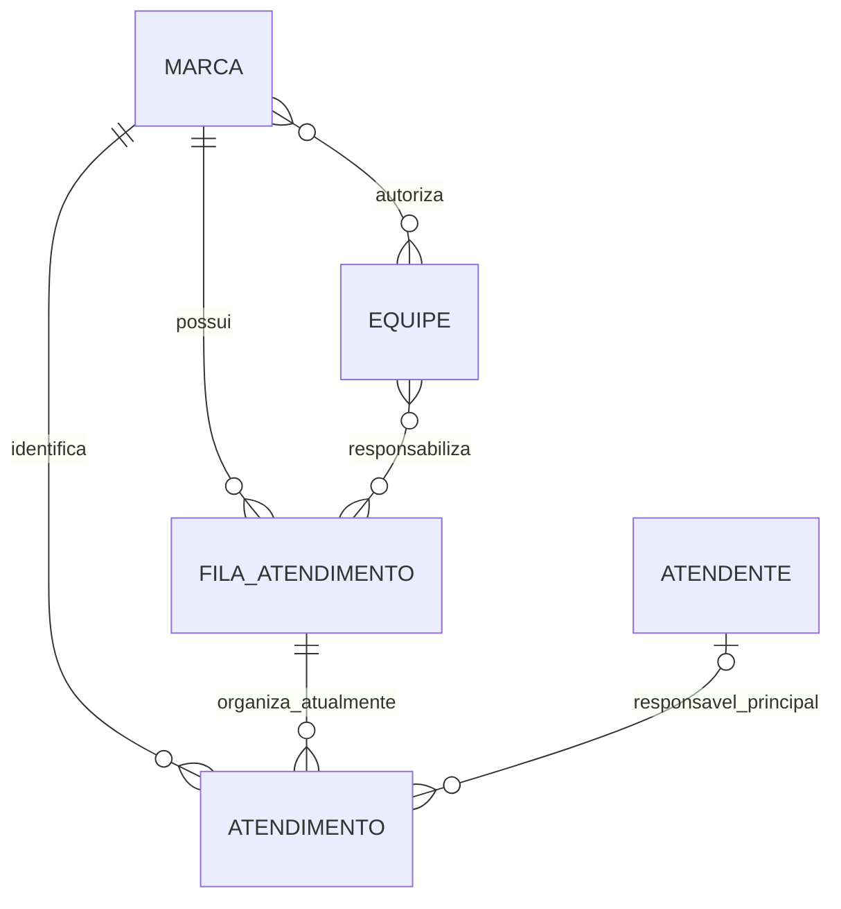

# Registro de decisões do planejamento

Este registro preserva as escolhas confirmadas na conversa e sua evolução.
O [desenho do MVP](especificacao-mvp.md) detalha as propostas de fechamento e o
[plano de execução](plano-de-execucao.md) organiza o trabalho em paralelo.
Data de início em 2026-11-07.

## Versão operacional atual

O responsável escolheu a V2 com perfis de combinações configuráveis, sem soma
de pesos, conforme D011. D001 a D007 permanecem como base. D008 e partes de
D009/D010 foram substituídas; seus textos abaixo são histórico das decisões
anteriores. O desempate por maior tempo sem receber caso permanece confirmado.
O [fluxo operacional](fluxo-operacional.md) descreve a versão atual.
A classificação inicial vem dos canais simulados. O Jev preenche apenas campos
ausentes na primeira entrega, conforme D015.

## D001 — Rails como API e React na interface

**Estado:** confirmado pelo responsável pelo projeto.

- A aplicação principal de backend utilizará Ruby on Rails como API.
- A interface web utilizará React.
- A alternativa de interface renderizada por Rails com Hotwire foi discutida;
  o responsável escolheu Rails como API + React.
- Aprender e conseguir explicar as decisões e a implementação é um objetivo
  explícito do projeto. O uso de agentes deve apoiar esse aprendizado.

### Implicações para o planejamento

- Definir contratos entre interface e API antes de dividir tarefas dependentes.
- Prever verificação da API, da interface e dos fluxos integrados.
- A separação entre React e Rails é uma escolha de interface e API. A organização
  interna do backend foi definida posteriormente na decisão D002.

### Escolhas não incluídas nesta decisão

- Versões de Ruby, Rails e React; JavaScript ou TypeScript; ferramentas de build.
- Banco de dados: PostgreSQL foi sugerido, mas ainda não foi confirmado.
- Broker, processamento em segundo plano e transporte de atualizações da tela.
- Organização dos repositórios, publicação e ambiente de execução.

## D002 — Monólito modular no MVP e na apresentação

**Estado:** confirmado pelo responsável pelo projeto.

- O backend do MVP será uma aplicação Rails organizada em módulos com
  responsabilidades explícitas.
- A interface permanece em React, conforme D001.
- A escolha busca viabilizar a entrega e o aprendizado com menor custo de
  coordenação e operação do que um backend dividido em serviços autônomos.
- Processos de segundo plano podem executar separadamente da API usando o
  mesmo código Rails. Seus detalhes ainda serão definidos.
- Broker e atendente simulado fazem parte da integração do desafio; sua presença
  como componentes separados é compatível com o monólito modular.

### Evolução futura

O responsável considera extrair serviços independentes caso haja interesse da
CloudWalk em continuar o projeto. Essa evolução é uma possibilidade posterior
ao MVP e à apresentação. Fronteiras claras entre módulos podem ajudar, mas uma
extração exigirá reavaliar contratos, dados, consistência, implantação e operação.

### Detalhamento pendente

Responsabilidades e interfaces dos módulos, propriedade dos dados, regras de
acesso e processos de execução serão definidos nas próximas etapas do escopo.

## D003 — Equipes compartilháveis entre marcas

**Estado:** confirmado pelo responsável pelo projeto.

- Uma equipe pode atuar em várias marcas, mediante autorização explícita para
  cada marca. Uma marca pode habilitar várias equipes.
- A relação entre marcas e equipes é muitos para muitos; os detalhes de
  persistência serão definidos no modelo de dados.
- Compartilhar uma equipe preserva a identificação da marca de cada atendimento.
- A autorização precisa ser respeitada pela aplicação, inclusive no acesso
  direto à API e no encaminhamento de casos, além da apresentação na interface.

### Verificação da decisão

- Uma equipe autorizada nas marcas A e B consegue atuar em ambas.
- A mesma equipe não consegue atuar na marca C sem autorização.
- O encaminhamento de um caso para equipe não habilitada para sua marca é
  recusado pela aplicação.

### Detalhamento pendente

Permissões individuais e por perfil e identidade/histórico dos clientes entre
marcas ainda precisam ser definidos. A abrangência das filas foi definida na
decisão D004. O compartilhamento de equipes não determina essas outras escolhas.

## D004 — Filas por marca com visualização unificada

**Estado:** confirmado pelo responsável pelo projeto.

- Cada fila de atendimento pertence a exatamente uma marca. Uma marca pode
  possuir várias filas.
- Filas de marcas diferentes mantêm configurações e regras próprias, mesmo
  quando são atendidas pela mesma equipe.
- O analista pode consultar, em uma visualização unificada, os atendimentos das
  filas e marcas para as quais tem permissão.
- A visualização preserva a identificação da marca e da fila de cada caso.
- Reunir casos em uma tela não muda sua marca, seu encaminhamento ou as
  autorizações de acesso. Um filtro de tela não concede acesso adicional.

### Verificação da decisão

- Configurar as filas Financeiro da marca A e Financeiro da marca B e habilitar
  uma mesma equipe para atuar nas duas marcas.
- Um analista autorizado em ambas consegue consultar os casos das duas filas
  em uma listagem, identificando marca e fila de cada atendimento.
- Selecionar uma marca ou remover um filtro não permite acessar casos fora das
  permissões do analista; o acesso direto à API respeita a mesma restrição.
- Alterar a configuração de uma das filas não sobrescreve a configuração da
  outra.

### Detalhamento pendente

A quantidade de filas operacionais simultâneas foi definida na decisão D005.
A relação entre fila e equipes foi definida na decisão D006. Filtros disponíveis
e efeito de alterações de regras sobre casos existentes serão definidos em
decisões posteriores.

## D005 — Uma fila operacional ativa por atendimento

**Estado:** confirmado pelo responsável pelo projeto.

- Um atendimento em curso possui uma única fila operacional ativa.
- Uma transferência substitui a fila atual e preserva no histórico a origem,
  o destino e o momento da mudança.
- O histórico de passagens por outras filas não representa participação ativa
  simultânea nessas filas.
- Consultar o mesmo caso em várias visualizações autorizadas não cria novos
  atendimentos nem altera sua fila atual.

### Verificação da decisão

- Transferir um atendimento de Suporte geral para Financeiro: o caso deixa de
  constar como ativo na fila de origem e passa a constar na fila de destino.
- Consultar o atendimento após a transferência e verificar que mensagens e
  registro da mudança permanecem disponíveis a quem tem autorização.
- Solicitações concorrentes de transferência preservam uma única fila atual
  e um histórico coerente com as mudanças efetivadas.

### Detalhamento pendente

A relação entre fila e equipes foi definida na decisão D006. A responsabilidade
principal por atendimento foi definida na decisão D007. Regras de transferência,
tratamento de conflitos e comportamento da fila ao encerrar ou reabrir um
atendimento serão detalhados posteriormente. Transferências entre marcas não
foram aprovadas nesta decisão.

## D006 — Várias equipes por fila, respeitando a marca

**Estado:** confirmado pelo responsável pelo projeto.

- Uma fila pode ter várias equipes responsáveis, e uma equipe pode ser
  responsável por várias filas.
- Todas as equipes responsáveis por uma fila precisam estar explicitamente
  autorizadas para a marca dessa fila.
- O atendimento pertence a uma marca, e sua fila atual precisa pertencer à mesma
  marca: `marca(atendimento) = marca(fila_atual)`.
- A marca é o escopo operacional das filas e da atuação das equipes. Isso
  preserva D003: uma equipe pode estar autorizada para mais de uma marca e
  participar das filas correspondentes.
- Ter autorização para atuar em uma marca não atribui automaticamente a equipe
  a todas as filas dessa marca; a responsabilidade pela fila é um vínculo
  explícito adicional.
- Transferir um atendimento entre filas não troca automaticamente sua marca.

### Verificação da decisão

- Uma fila da marca A aceita como responsáveis duas equipes autorizadas em A,
  mesmo que uma delas também esteja autorizada em B.
- Uma equipe autorizada somente em B não pode ser vinculada a uma fila de A.
- Um atendimento de A não pode ser encaminhado para uma fila de B pela operação
  comum de transferência de fila.
- Uma equipe habilitada em A, mas não vinculada a determinada fila de A, não é
  considerada responsável por essa fila apenas por ter autorização na marca.

### Detalhamento pendente

Distribuição entre equipes e atendentes, permissões individuais e tratamento da
revogação de autorizações com filas/casos ativos ainda serão definidos. A
responsabilidade principal por atendimento foi definida na decisão D007. O
vínculo com a equipe não determina, sozinho, todas as permissões individuais do
analista.

## D007 — Um responsável principal por atendimento

**Estado:** confirmado pelo responsável pelo projeto.

- Um atendimento tem no máximo um responsável principal ativo por vez.
- O responsável pode ser o atendente de IA simulado ou um analista humano.
- Várias equipes serem responsáveis pela fila não torna seus participantes
  responsáveis principais simultâneos por todos os casos dessa fila.
- A mudança de responsável preserva o histórico de atribuições, mensagens e
  decisões do atendimento.
- A atribuição respeita a marca, a fila atual e as permissões aplicáveis ao
  atendente. Trocar de responsável não muda automaticamente a marca do caso.

### Verificação da decisão

- Atribuir um caso ao atendente de IA e depois a um analista humano: somente o
  responsável atual consta como principal, com a mudança registrada no histórico.
- Duas tentativas concorrentes de assumir um caso não criam dois responsáveis
  principais ativos; o resultado efetivado permanece coerente com a auditoria.
- Um analista sem a autorização necessária não consegue assumir o atendimento,
  inclusive por acesso direto à API.

### Detalhamento pendente

A atribuição humana automática foi definida na decisão D010. Representação da
espera por um responsável, colaboração secundária e permissões de resposta
serão definidas no fluxo de atendimento. Suspensão da IA e tratamento de
respostas antigas durante o handoff também precisam ser detalhados.

## D008 — Peso integral durante a espera pelo cliente

**Estado:** histórico; substituído pela adoção da V2 ajustada em D011.

- Um atendimento atribuído ao analista mantém seu peso integral no cálculo de
  carga enquanto aguarda resposta do cliente.
- A espera, por si só, não libera nem reduz capacidade. Fechar a conversa na
  interface ou alterar um filtro também não libera pontos.
- Exemplo ilustrativo: capacidade 5, casos de pesos 1 e 3; se o caso de peso 3
  aguarda o cliente, a carga permanece 4 e a capacidade livre permanece 1.
- A política de retorno do cliente não precisa recompor pontos que tenham sido
  liberados pela espera, pois o peso permaneceu reservado. Mudanças de peso,
  capacidade ou responsável continuam exigindo regras próprias.

### Verificação da decisão

- Colocar um caso em espera pelo cliente e confirmar que sua carga não muda.
- Receber a resposta desse cliente e confirmar que o caso não é contado duas
  vezes nem ganha outra atribuição apenas por ter saído da espera.
- Novas atribuições consideram também os casos atribuídos que aguardam cliente.

## D009 — Uma marca por vez na atuação do analista

**Estado:** parcialmente substituído por D011. A atuação em uma marca por vez
permanece; a condição antiga de zerar todas as pendências antes da troca é histórica.

### Histórico da política anterior

Os itens e verificações desta seção registram o desenho anterior. A regra atual
de troca está em D011 e no fluxo operacional; o antigo bloqueio por qualquer
pendência não deve ser implementado como regra da V2.

- Um analista humano atende operacionalmente uma marca por vez, para reduzir
  confusão de contexto.
- Ele e sua equipe podem continuar autorizados em várias marcas, conforme
  D003; autorização e atuação no momento são conceitos distintos.
- A elegibilidade para novas atribuições considera a marca em operação, além
  das permissões e da capacidade do analista.
- A visão unificada de D004 continua sendo uma capacidade de consulta sujeita
  às permissões. Regras de exibição e de atuação na marca selecionada serão
  detalhadas no fluxo da interface.
- A restrição foi solicitada para o analista humano. A concorrência do atendente
  de IA continua pendente e não é presumida equivalente à capacidade humana.
- Para trocar de marca, o analista precisa primeiro concluir ou transferir todos
  os casos anteriores sob sua responsabilidade, inclusive os que aguardam o
  cliente. A troca fica bloqueada enquanto houver esses casos.
- Transferir significa efetivar a passagem da responsabilidade para outro
  atendente elegível. Não significa mudar a marca do atendimento ou apenas
  retirar o caso da tela.

### Verificação da decisão

- Um caso aberto ou aguardando cliente da marca A sob responsabilidade do
  analista impede a troca para B, inclusive por acesso direto à API.
- Depois de concluir ou transferir todos os casos anteriores, o analista pode
  mudar para outra marca autorizada sem perder o histórico das atribuições.
- Uma tentativa de transferência não efetivada não libera o analista para
  trocar de marca.

### Detalhamento pendente

Detalhar o procedimento para preparar a troca, a suspensão de novas atribuições
nesse intervalo e a verificação conjunta de marca em operação e casos restantes.
Não foi aprovada transferência automática nem abandono de casos ao trocar de
marca. O procedimento proposto será revisado no fluxo operacional.

## D010 — Distribuição automática por menor carga absoluta

**Estado:** parcialmente substituído por D011. A soma de pesos abaixo é histórica;
o desempate por maior tempo sem receber atribuição permanece confirmado. O novo
critério principal de comparação entre candidatos ainda precisa ser definido.

### Regra aprovada à época — histórico

Os itens abaixo documentam o modelo por pontos e suas verificações anteriores.
São histórico, não critérios de implementação da V2. D011 registra a retirada
dos pesos e a preservação do desempate.

- Atribuir automaticamente atendimentos humanos por menor carga absoluta,
  considerando a soma dos pesos dos casos contabilizados para cada analista.
- A capacidade configurada serve como condição para admitir um novo caso;
  não divide nem normaliza a carga no critério de escolha. A alternativa por
  ocupação percentual foi discutida e o responsável escolheu carga absoluta.
- A comparação ocorre entre analistas elegíveis para a marca em operação e a
  fila, disponíveis e com capacidade para o peso do novo caso.
- Em empate de carga absoluta, escolher quem está há mais tempo sem receber
  uma atribuição. Tratamento de candidatos sem atribuições anteriores e empate
  residual de horário será detalhado na especificação.
- Os pesos por tipo de atendimento e a capacidade por analista são
  configuráveis na plataforma.
- Um analista pode ser responsável por vários atendimentos simultaneamente,
  preservando D007: cada atendimento tem apenas um responsável principal ativo.
- Exemplo do responsável: capacidade de 5 pontos; um caso de peso 1 e outro de
  peso 3 ocupam 4 pontos e deixam 1 ponto disponível. O número 5 é ilustrativo,
  não uma capacidade global aprovada.

### Detalhamento anterior de execução — histórico

- Carga consumida é a soma dos pesos dos casos que contam para capacidade.
  Uma nova atribuição só cabe se carga atual mais peso do novo caso não exceder
  a capacidade, respeitando também marca em operação, fila, equipes,
  disponibilidade e as permissões aplicáveis.
- Recomenda-se uma carga única do analista nas filas em que mantém casos
  atribuídos, evitando reservar a capacidade inteira separadamente em cada fila.
  Conforme D009, os casos anteriores precisam ser concluídos ou transferidos
  antes de mudar a marca em operação.
- Entre os candidatos que passam pelas restrições, escolher quem possui a menor
  soma de pesos, mesmo que as capacidades configuradas sejam diferentes.
- Verificar e reservar capacidade junto com a atribuição, de modo que duas
  atribuições concorrentes não consumam a mesma capacidade restante.
- Prioridade do caso define ordem de atendimento; peso estima o consumo de
  capacidade. São conceitos distintos.
- Pesos são aproximações configuráveis de esforço, não medidas comprovadas de
  produtividade humana. Poucos pesos estáticos por categoria são uma opção de
  recorte inicial; a configuração e sua calibração ainda serão definidas.

### Políticas que estavam pendentes no modelo anterior — histórico

- A troca de marca exige concluir ou transferir os casos anteriores conforme
  D009; seu procedimento de execução ainda será detalhado. A espera pelo cliente
  mantém peso integral conforme D008.
- Se haverá também teto de quantidade de casos simultâneos. Uma eventual cota
  de novos casos por intervalo de tempo é outra regra e requer confirmação.
- Como obter o peso inicial, reclassificar casos e aplicar alterações de peso
  ou capacidade aos atendimentos existentes.
- Como ordenar casos que aguardam vaga e tratar casos pesados que não cabem,
  evitando que fiquem indefinidamente sem atendimento.
- Escopo das intervenções manuais e tratamento de disponibilidade do analista.
- Política própria de concorrência do atendente de IA; capacidade humana não
  será presumida como limite de execução do simulador.

### Verificações do modelo anterior — histórico

- Ana tem capacidade 5 e carga 3; Bruno tem capacidade 10 e carga 4. Ambos
  elegíveis e disponíveis: um caso de peso 1 vai para Ana, pela menor carga.
- No mesmo exemplo, um caso de peso 3 não cabe em Ana e pode ir para Bruno.
- Entre dois candidatos elegíveis de mesma carga, recebe o caso quem teve sua
  última atribuição há mais tempo.
- No exemplo de capacidade 5 e carga 4, um caso de peso 1 cabe; peso 2 não cabe.
- Duas atribuições concorrentes não ultrapassam a capacidade admitida pela
  política; uma mesma pessoa em várias equipes não é contada como candidatos
  independentes nem recebe reservas duplicadas.
- Sem candidato elegível com capacidade, o caso permanece aguardando na fila.
- Comparar distribuição por contagem e por pesos no mesmo cenário sintético,
  medindo ocupação estimada, espera e respeito aos limites. O resultado não
  comprova efeitos sobre produtividade humana em uma operação real.

### Referências consultadas

- [Salesforce: pesos em unidades de capacidade](https://help.salesforce.com/s/articleView?id=service.omnichannel_configure_work_items_as_primary_or_interruptible.htm&language=en_US&type=5).
- [Zendesk: capacidade e conversas inativas](https://support.zendesk.com/hc/en-us/articles/4776409839770-Creating-capacity-rules-to-balance-agent-workloads).

### Revisão crítica das políticas

Uma [análise de limites e alternativas](revisao-critica-e-alternativas.md)
compara a versão anterior com melhorias compatíveis e uma alternativa operacional.
A análise registra o momento anterior à escolha da V2 ajustada, feita em D011.

## D011 — V2 com combinações configuráveis e limite de carteira

**Estado:** direção operacional escolhida pelo responsável; semântica dos tipos
e detalhes de aplicação das combinações permanecem em definição. D012 esclarece
que os exemplos eram níveis de prioridade e D013 confirma o uso conjunto de
prioridade e categoria, sem escala de complexidade.

### Escolhas confirmadas

- Adotar a V2: separar responsabilidade pelo caso de trabalho ativo, mantendo
  um responsável principal e uma fila operacional atual por atendimento.
- O analista atua em uma marca por vez, mas pode manter casos aguardando cliente
  em outras marcas autorizadas. A retomada precisa respeitar marca e capacidade.
- Substituir pesos numéricos por regras configuráveis que expressem combinações
  de casos que cada analista pode conduzir simultaneamente.
- A operação configura essas regras pela interface, sem alteração de código.
- As combinações consideram prioridade e categoria, conforme D013; não há
  classificação adicional de complexidade.
- Exemplos apresentados: um urgente exclusivo; um urgente de outro tipo e um
  básico; três básicos e um intermediário; um avançado e um intermediário.
  O responsável esclareceu em D012 que pensava em prioridade. Os nomes definitivos
  e a distinção entre os dois exemplos de urgente ainda serão definidos.
- Impor limite à carteira de casos atribuídos, incluindo os que aguardam cliente,
  para evitar acumular pendências sem limite e uma onda excessiva de retomadas.
- Preservar o desempate por maior tempo sem receber uma atribuição.

### Detalhamento proposto, ainda não confirmado

- Um perfil contém combinações alternativas que funcionam como tetos. Um conjunto
  menor que uma combinação também cabe; os tetos de combinações diferentes não
  são somados. Exemplos e consequências estão em
  [perfis de capacidade](perfis-de-capacidade.md).
- Validar a combinação de trabalho ativo e um teto total de carteira, contando
  cada atendimento uma vez em todas as marcas/equipes do analista.
- Em geral, espera pelo cliente mantém responsabilidade e vaga na carteira total;
  quando há retorno, o caso aguarda retomada se não houver combinação ativa
  compatível. Exclusividade de urgentes durante a espera ainda precisa ser decidida.

### Pendências importantes

- Nomes e ordem dos níveis de prioridade, catálogo de categorias e condições
  concretas das combinações. D012 e D013 já definem os critérios usados.
- Se exclusividade de um caso urgente permanece durante a espera pelo cliente.
- Valor e abrangência dos tetos de carteira e eventuais limites por tipo; nenhum
  número global foi aprovado e vinte pendências não é uma meta aceita.
- Qual critério principal escolhe entre vários candidatos após remover pesos.
  Menor quantidade de casos ativos é uma proposta, não uma escolha confirmada.
- Ordem de retomadas, novos casos e marcas; disponibilidade e transferência quando
  o responsável não puder retomar; efeito de alterações de perfil em casos existentes.

### Efeitos no histórico

D008 deixa de ser a política geral vigente. D009 preserva uma marca de atuação,
mas permite a carteira com pendências de outras marcas conforme V2. D010 mantém
o desempate, enquanto sua comparação por soma de pesos foi retirada. A estrutura
de equipes compartilháveis, filas por marca e responsabilidade única permanece.

## D012 — Prioridade como critério dos perfis; complexidade não exigida

**Estado:** significado dos exemplos esclarecido pelo responsável.

- Básico, intermediário e avançado foram pensados como níveis de prioridade,
  não como escala de complexidade ou esforço.
- O TAPI pede filas configuráveis por marca, equipe, categoria ou prioridade,
  além de triagem, priorização e distribuição. Não exige pontuação de esforço,
  campo de complexidade ou perfis de combinações simultâneas.
- Os perfis e a gestão de carteira da V2 são escolhas do projeto; não devem ser
  apresentados como requisitos literais do parceiro.
- Não acrescentar uma classificação obrigatória de complexidade ao modelo atual.
  As regras de combinações podem usar os níveis de prioridade configurados.
- Se os exemplos de urgente tiverem regras diferentes, será necessário explicitar
  a condição que os distingue. O uso de categoria foi posteriormente confirmado
  em D013, sem acrescentar complexidade ao modelo.

### Ainda em aberto

Nomes definitivos e ordem das prioridades, critérios de sua definição/alteração
e condições concretas por categoria para urgentes. Os números das combinações
continuam exemplos de configuração, sem limites globais aprovados.

## D013 — Combinações por prioridade e categoria

**Estado:** confirmado pelo responsável pelo projeto.

- As combinações de atendimento simultâneo serão configuradas por prioridade
  e categoria.
- Não criar escala adicional de complexidade nem retomar pesos numéricos.
- Casos de mesma prioridade podem ter regras diferentes conforme a categoria,
  quando isso estiver explicitamente configurado pela operação.
- Nomes de níveis, categorias, combinações e limites concretos ainda serão
  definidos no recorte do MVP. Os exemplos anteriores não são uma configuração
  global já aprovada.

### Verificação da decisão

- Conseguir explicar uma permissão ou recusa de nova atribuição pelos critérios
  de prioridade/categoria e pelo perfil configurado, sem depender de complexidade.
- Configurar regras distintas para duas categorias de mesma prioridade e verificar
  o comportamento de cada combinação no perfil correspondente.

### Bloco posteriormente aprovado

O responsável aprovou em D014 o ciclo completo do canal simulado à IA, handoff,
atendimento humano, espera, retomada e resolução. Detalhes finais do algoritmo
serão resolvidos a partir desse ciclo, sem presumir uma nova regra de ordenação
após a retirada dos pesos.

## D014 — Ciclo principal do MVP

**Estado:** aprovado pelo responsável como base do MVP.

| Etapa | Comportamento aprovado |
| --- | --- |
| Entrada | Solicitação por chat, WhatsApp ou e-mail simulados, vinculada a uma marca. |
| Atendimento pela IA | O atendente simulado recebe o caso e responde ou solicita encaminhamento humano. |
| Aguardando humano | Caso permanece na fila da marca, com resumo, contexto e histórico, até haver analista elegível. |
| Atendimento humano | Um analista é responsável, respeitando perfil, carteira e marca em operação. |
| Aguardando cliente | Mantém responsável e vaga na carteira; ocupação ativa segue a política configurada. |
| Aguardando retomada | Resposta do cliente provoca verificação de disponibilidade, marca e combinação antes de retomar. |
| Resolvido | Encerra o atendimento e libera sua ocupação, preservando mensagens e auditoria. |

### Alcance da aprovação

O ciclo conceitual foi aprovado; nomes de campos/enums, exceções, reabertura,
timeouts e regras de transição ainda serão detalhados. A atribuição de prioridade
e categoria é o primeiro ponto dessa definição.

### Verificação do ciclo

- Demonstrar um atendimento respondido e resolvido pelo atendente simulado.
- Demonstrar um atendimento encaminhado ao humano com resumo e contexto,
  aguardando atribuição quando necessário e depois respondido por um analista.
- Demonstrar espera pelo cliente e retomada sem duplicar o caso, seu responsável
  ou sua vaga na carteira.

### Classificação inicial definida posteriormente

O responsável escolheu em D015 receber categoria e prioridade dos canais
simulados. A plataforma valida esses dados antes de utilizá-los. O tratamento
de campos ausentes e as alternativas de contingência estão em
[triagem e classificação](triagem-e-classificacao.md).

## D015 — Campos dos canais simulados e complemento pelo Jev

**Estado:** confirmado para a primeira entrega.

- Os canais simulados enviam categoria e prioridade junto da solicitação.
- A plataforma valida e registra os valores recebidos e os utiliza nas regras
  de encaminhamento e distribuição.
- Receber classificação pronta é uma escolha do MVP, não uma garantia do TAPI
  sobre canais reais. Chat, WhatsApp e e-mail continuam simulados no recorte.
- Quando categoria e prioridade forem válidas, a plataforma envia o atendimento
  diretamente ao agente de atendimento pelo broker.
- O Jev preenche somente categoria ou prioridade ausentes. Se ambos estiverem
  ausentes, pode completar os dois. Valores válidos recebidos são preservados.
- A plataforma valida a classificação completada antes do envio pelo broker.

### Verificação da decisão

- Com ambos os campos válidos, o atendimento segue ao agente pelo broker.
- Com apenas um campo ausente, o Jev preenche somente esse campo e o outro
  permanece com o valor recebido.
- Com ambos ausentes, os dois valores retornados são validados antes do envio.

### Detalhamento recomendado para avaliação

- Distinguir ausente de inválido: vazio/ausente pode acionar complemento, enquanto
  valor fora do catálogo não deve ser corrigido silenciosamente.
- Preservar campos válidos e preencher apenas os ausentes.
- Usar somente valores permitidos para a marca e validar o resultado do modelo
  antes de encaminhar o caso. Jev não decide permissões, carteira ou capacidade.
- Persistir a entrada e executar o complemento em segundo plano; falha ou
  incerteza mantém o caso rastreável para tratamento humano a definir.
- Manter o classificador de contingência separado do atendente de IA simulado.
  Ele não substitui a integração de atendimento/handoff do ciclo aprovado.

### Avaliação da contingência

Medir acerto por campo, erros de prioridade urgente, cobertura automática,
latência, falhas e custo com relatos sintéticos em português. A versão do
modelo, limiares, prazos e política de falhas ainda precisam ser definidos.

## Relações de domínio já confirmadas

O diagrama representa relações de negócio, sem fixar tabelas ou tecnologias.
A relação com a fila atual considera os atendimentos em curso; o histórico de
transferências será detalhado no modelo completo.

Restrição adicional: as equipes de uma fila precisam estar habilitadas para a
marca dela, e a marca da fila atual precisa coincidir com a do atendimento.
O limite de responsabilidade principal é de um atendente por caso; os estados
em que o caso pode aguardar atribuição ainda serão detalhados.

## Fechamento proposto para o MVP

A [especificação](especificacao-mvp.md) propõe as regras de transição,
distribuição e retomada, o tratamento de falhas, o modelo relacional, os
contratos de integração, as telas e a stack complementar. Os valores de
demonstração e as políticas adicionais ainda são propostas para revisão.
O [plano de execução](plano-de-execucao.md) traz o backlog com dependências,
cenários de aceite e metodologia experimental.

## Restrições e informações pendentes

- O enunciado estima um mês de projeto individual; prazo real e horas semanais
  disponíveis ainda não foram informados.
- Dez mil conexões de chat é a interpretação proposta para testar a hipótese de
  pico sugerida pelo responsável. O cenário exploratório explicita a taxa de
  mensagens. Capacidade e ambiente do ensaio serão registrados na execução.
- As anotações azuis do PDF foram feitas pelo responsável e representam dúvidas,
  não requisitos adicionais do parceiro.
