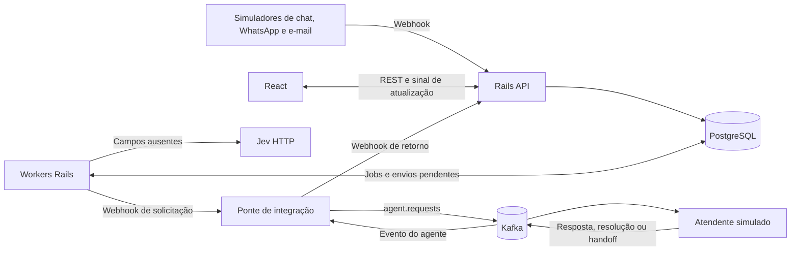
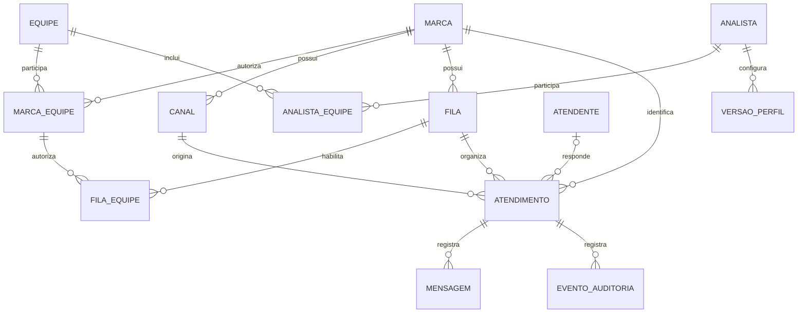

# Especificação do MVP de help desk CloudWalk

Base para desenvolvimento e revisão. As decisões confirmadas estão no [registro](decisoes.md). As regras operacionais, tecnologias auxiliares e metas numéricas abaixo fecham o desenho como **propostas para o MVP**. O [plano de execução](plano-de-execucao.md) define dependências, entregas e verificações.

## 1. Escopo e demonstração

O MVP recebe solicitações sintéticas por chat, WhatsApp e e-mail, organiza os casos em filas configuráveis, integra um atendente de IA simulado e entrega casos escalados a analistas com o histórico completo. O chat exibe atualizações durante a sessão. WhatsApp e e-mail são simulados como conversas assíncronas que podem ser consultadas posteriormente. A execução local usa Docker Compose, dados de demonstração e um mock determinístico do atendente. [Enunciado do TAPI](../../TAPI_Inteli_CloudWalk_HelpDesk_AgentesIA.pdf)

| Critério | Evidência na apresentação |
| --- | --- |
| AI first | Todo caso com classificação válida começa pelo atendente simulado via broker. Demonstrar um caso respondido e resolvido pela IA e um caso escalado com resumo e histórico. O Jev entra somente para completar a classificação. |
| Multimarca | Duas marcas sintéticas, com pelo menos duas filas por marca. O mesmo assunto pode seguir filas distintas em marcas diferentes. Um analista autorizado consulta ambas e atua em uma por vez. Uma credencial sem acesso à segunda marca recebe `403` ou `404` ao tentar consultar ou agir nela. |
| Multiequipes | Três equipes no seed, com uma compartilhada pelas duas marcas. Uma fila tem duas equipes responsáveis. Uma pessoa que integra ambas é avaliada uma vez. A interface permite alterar as equipes da fila e rejeita equipe sem vínculo com a marca. |
| Operável | Um supervisor cria e edita filas e regras de entrada, vínculos com equipes e perfis de capacidade pela interface. Alterações influenciam os próximos encaminhamentos e aparecem na auditoria. |
| Rastreável | A partir de um caso, é possível seguir entrada, classificação, mensagens, handoff, atribuição, retomada e resolução, com horário, ator, motivo e IDs de correlação. |
| Reproduzível | Instalação limpa conforme README, roteiro de demonstração, integração real com o broker, testes dos fluxos e um experimento com dados, resultados e limitações. |

O atendente real da CloudWalk, dados reais, integrações de produção e app móvel ficam fora da entrega. O recorte também deixa para evolução futura anexos, SLAs contratuais, base vetorial, omnicanalidade real, automações livres e administração avançada. Chatwoot e Zammad são referências de interface e operação. O TAPI descreve problemas com o fornecedor atual e a necessidade de controle da plataforma, sem explicar a avaliação de cada alternativa open source. [Enunciado do TAPI](../../TAPI_Inteli_CloudWalk_HelpDesk_AgentesIA.pdf)

## 2. Regras operacionais

### Entrada, classificação e fila

- A credencial do canal simulado identifica a marca. O primeiro evento identifica cliente e conversa externos. Cada evento válido tem um ID estável para reentrega. O Rails persiste a entrada antes de responder `202` e guarda o caso na fila padrão da marca enquanto classifica. O mesmo ID com outro conteúdo recebe `409`.
- A ordem proposta é **Urgente → Avançado → Intermediário → Básico**. Categorias do seed são Pix, Repasses e Maquininha. Cada marca habilita categorias próprias. Cada prioridade tem uma definição no catálogo da demo. Urgente indica necessidade imediata, avançado indica impacto relevante sem urgência imediata, intermediário indica impacto moderado e básico cobre orientações rotineiras. Essa ordem determina precedência de atendimento. Categoria identifica o assunto e as duas dimensões compõem o perfil de capacidade.
- Após validar a classificação, o Rails escolhe a primeira regra ativa da marca, em ordem configurada pelo supervisor. Cada regra pode restringir categoria, prioridade ou ambas e aponta para uma fila da mesma marca. A fila padrão é a última opção. Cada marca mantém uma fila padrão ativa e cada fila ativa tem pelo menos uma equipe responsável. A regra escolhida e sua versão ficam no histórico. Alterações aplicam-se a novos encaminhamentos. Um caso em curso muda de fila somente por transferência explícita da operação. Para desativar fila, a operação precisa retirar referências em regras ativas e transferir casos em curso. O histórico permanece consultável.
- Os dois campos válidos encaminham o caso ao atendente simulado pelo broker. Campo ausente, `null` ou vazio aciona o Jev em segundo plano, desde que os campos presentes sejam válidos. Um identificador fora do catálogo ou de tipo incorreto coloca o caso em revisão de classificação. Correção explícita por supervisor segue para o atendente simulado depois da validação.
- O adaptador Rails usa Jev via HTTP com `Choice`, envia texto sintético e apenas perguntas dos campos ausentes, com os valores do catálogo e a opção `informacao_insuficiente`. O backend preserva valores válidos de entrada e valida todos os resultados antes de aceitar o complemento. Se faltar algum resultado válido, a classificação fica em revisão. Proposta inicial de timeout de 5 s por tentativa, com até uma repetição para timeout, `429` ou falha transitória, respeitando `Retry-After` quando fornecido. Sem credencial ou diante de falha definitiva, o motivo fica visível em revisão. Uma correção humana posterior invalida a resposta pendente do modelo. Registrar versão, resultado, confiança retornada e latência. A primeira política aceita escolhas válidas com opção de abstenção e mede empiricamente os erros. [API Jev Choice](https://docs.typesafe.ai/primitives/choice)

### Capacidade e distribuição humana

- Cada analista tem um perfil ativo com alternativas de combinações e um teto de carteira. Cada combinação lista pares exatos de prioridade e categoria com seus limites. Um conjunto de casos ativos cabe quando todos os pares e suas quantidades cabem **na mesma alternativa**. Par ausente nessa alternativa tem limite zero. Os tetos de alternativas nunca se somam. A interface edita os pares com seletores e quantidades inteiras positivas, valida duplicatas, publica uma versão e exige que o teto da carteira seja pelo menos o maior total de uma combinação.
- Exemplo de perfil de demonstração com carteira **6**. A operação pode ajustar por analista.

| Alternativa | Máximo simultâneo |
| --- | --- |
| 1 | 1 Urgente · Pix |
| 2 | 1 Urgente · Maquininha + 1 Básico · Maquininha |
| 3 | 3 Básicos · Pix + 1 Intermediário · Repasses |
| 4 | 1 Avançado · Repasses + 1 Intermediário · Repasses |

- A carteira soma os casos atribuídos em atendimento humano, aguardando cliente ou aguardando retomada, em todas as marcas. Um caso que aguarda cliente libera capacidade ativa, inclusive quando era urgente exclusivo. Ele mantém uma vaga de carteira e, quando retorna, disputa a capacidade com o perfil atual. Se seis retornarem juntos, permanecem com o mesmo responsável e entram em trabalho ativo somente os que couberem.
- Um candidato precisa estar disponível para receber, operar na marca do caso, ter acesso por equipe responsável pela fila e ter espaço na carteira e na combinação ativa. Entre elegíveis, vence quem tem **menos casos ativos**. Em empate, vence quem está há mais tempo sem receber uma atribuição nova, com quem nunca recebeu primeiro e ID estável no empate final. Uma retomada sem troca de responsável mantém a data da última atribuição.
- O distribuidor examina casos e retomadas por prioridade e pela hora em que ficaram elegíveis para atendimento humano, dando preferência a retomada no empate exato. Após 15 minutos de espera, o item entra no grupo mais antigo, ordenado pelo tempo de espera. Essa precedência não altera a prioridade usada no perfil. Um item sem encaixe mantém seu lugar, com causa registrada, e a busca avança aos próximos. A fila é reavaliada ao mudar disponibilidade, perfil, marca ativa ou capacidade e por verificação periódica. A interface exibe idade e bloqueio. O supervisor pode transferir um caso persistente, inclusive de retomada, mantendo a marca.
- O analista prepara a troca de marca suspendendo novas atribuições e retomadas. Pode responder e concluir os casos ativos ou pedir transferência. Ao zerar os ativos, a troca é efetivada atomicamente. A carteira em espera fica vinculada ao analista e retorna apenas na marca em operação, ou após transferência explícita. Indisponibilidade suspende novas atribuições e retomadas. O supervisor pode transferir a carteira se necessário. Revogar acesso impede novas ações imediatamente. Casos que perderam o único responsável elegível voltam ao grupo humano sem responsável, com histórico. Casos ainda aguardando cliente mantêm a espera sem responsável e retornam ao grupo humano quando o cliente responde. Alterações de equipe, fila e permissões verificam esse efeito antes de publicar.
- Reclassificação por supervisor exige motivo, é auditada e conserva a fila atual. Perfil editado ou reclassificação que deixe casos ativos fora da combinação mantém os atendimentos em andamento e bloqueia entradas e retomadas para aquele analista até o conjunto voltar a caber. Redução de teto abaixo da carteira atual bloqueia novas atribuições e permite retomadas dos casos já contados, respeitando a combinação ativa. Transferência aceita pelo sistema aplica as mesmas regras de elegibilidade ao destino. Uma transferência para nova fila pode devolver o caso ao grupo sem responsável até haver encaixe.

### Estados e ações

| Situação | Gatilho e condição | Resultado |
| --- | --- | --- |
| Entrada recebida | Classificação válida, ausente ou inválida | Encaminha à IA, aguarda Jev ou fica em revisão de classificação, respectivamente. |
| Aguardando Jev ou em revisão | Resultado válido do Jev ou correção válida do supervisor | Define fila, atribui a IA e grava o envio pendente. Falha ou abstenção fica em revisão. |
| IA em atendimento | Resposta, resolução ou handoff do mock para a rodada vigente | Publica resposta no histórico. Pode continuar, resolver ou encaminhar ao humano. Handoff exige resumo e referências às mensagens, preserva a conversa e libera a IA. |
| Aguardando atribuição humana | Motor encontra analista elegível | Analista passa a ser responsável e o caso passa a ativo. Sem candidato, fica visível na fila. |
| Humano ativo | Responsável responde, solicita informação ou resolve | Resposta mantém ativo. Solicitar informação registra a mensagem e passa para aguardando cliente. Resolver libera capacidade e carteira. |
| Aguardando cliente | Cliente responde | Mantém fila e, quando há responsável, aguarda retomada com ele. Caso sem responsável volta a aguardar atribuição humana. |
| Aguardando retomada | Perfil, marca ativa e disponibilidade do responsável permitem | Volta a humano ativo. Novas mensagens enquanto aguarda são anexadas à mesma conversa. |
| Resolvido | Cliente envia nova solicitação na mesma conversa externa | Cria novo caso ligado ao anterior e reinicia a classificação. A interface mantém acesso ao caso anterior conforme autorização. |

Falha de integração aparece com motivo e tentativa em andamento, ou com ação de recuperação do supervisor após esgotar tentativas. Na indisponibilidade persistente do atendente simulado, o supervisor pode escalar o caso com resumo de contingência e auditoria. A resolução mantém mensagens, fila final, histórico de responsáveis e vínculo com casos anteriores. Um comando que não corresponde à situação atual retorna conflito e a interface recarrega o caso.

## 3. Arquitetura e responsabilidades

**Rails API + React em monólito modular**, com PostgreSQL para persistência, Apache Kafka em KRaft para eventos do atendente e Docker Compose para execução. A demonstração usa um broker single-node com replicação 1; o endpoint interno é `kafka:9092`, sem porta publicada no host. React usa TypeScript e Vite. O servidor HTTP e os workers Rails compartilham código e banco. A ponte de integração e o mock rodam em processos separados no mesmo ambiente local. A ponte recebe os webhooks e publica ou consome eventos; o mock representa o serviço externo de IA da CloudWalk. [Rails API](https://guides.rubyonrails.org/api_app.html) · [Vite](https://vite.dev/guide/) · [Apache Kafka](https://kafka.apache.org/documentation/)

Jobs internos usam Active Job com Solid Queue em PostgreSQL. Classificações e atribuições pendentes permanecem consultáveis pelo estado do caso. O job roda após o commit e uma verificação periódica retoma pendências quando o agendamento falha. O outbox preserva os envios do Rails ao broker. [Active Job](https://guides.rubyonrails.org/active_job_basics.html) · [Outbox transacional](https://docs.aws.amazon.com/prescriptive-guidance/latest/cloud-design-patterns/transactional-outbox.html)

| Módulo Rails | Responsabilidade |
| --- | --- |
| Operação | Marcas, equipes, vínculos, filas, regras de entrada, catálogo, perfis, presença e marca em operação. Controla permissões e edições. |
| Atendimento | Entrada canônica, estados, identidade do caso, mensagens, responsável atual, resolução e histórico. É o único módulo que aplica transições. |
| Triagem e distribuição | Validação, complemento por adaptador Jev, escolha de fila, elegibilidade, ordenação, atribuição e retomada. Aciona as transições de Atendimento. |
| Integração | Webhooks assinados, envios persistidos, comunicação com a ponte, deduplicação, novas tentativas e confirmação de resultados. |
| Auditoria | Eventos de negócio gravados junto à mudança, consulta por caso e correlação com erros de integração e métricas. |

PostgreSQL concentra as invariantes transacionais de fila de atendimento, responsabilidade e capacidade. Kafka foi escolhido como log de eventos da integração para aproximar a demonstração da referência da CloudWalk e permitir releitura enquanto os registros estiverem retidos. A demonstração usa `agent.requests`, `agent.events` e `agent.failures`, cada tópico com três partições e chave `case_id`; a ordenação é por partição, não global. `cleanup.policy=delete` e retenção padrão de sete dias (`KAFKA_RETENTION_MS`, em milissegundos) mantêm registros para replay limitado. O consumo não remove registros, e a expiração pode ocorrer conforme a retenção configurada. O PostgreSQL segue como histórico e auditoria duráveis do domínio; Kafka não promete replay eterno nem arquivamento completo. Solid Queue continua para jobs internos no PostgreSQL. [Configuração de tópicos Kafka](https://kafka.apache.org/documentation/#topicconfigs) · [Configuração do produtor Kafka](https://kafka.apache.org/documentation/#producerconfigs) · [Configuração do consumidor Kafka](https://kafka.apache.org/documentation/#consumerconfigs)

Dois trade-offs guiam a V2. Combinações expressam situações como urgente exclusivo e dão trabalho para configurar quando o catálogo cresce. Por isso, a demo usa poucos pares e verifica cobertura do catálogo. Contar casos ativos torna a distribuição explicável, mas a métrica não estima o esforço de cada caso. Uma retomada urgente pode aguardar enquanto a marca ou a combinação não permitir, com visibilidade e transferência pelo supervisor.

### Modelo relacional

- `Atendente` representa uma identidade humana ligada a um analista ou a identidade do mock. Um caso tem uma marca imutável, um canal da marca, uma fila atual da marca e zero ou um responsável principal. Equipes da fila referenciam vínculos `MarcaEquipe` da mesma marca. Validar essas relações por chaves estrangeiras compostas onde aplicável e pelas operações do domínio. Supervisor recebe autorização explícita por marca. Analista herda acesso por equipe vinculada à marca e responsável pela fila, inclusive para consultas em outras marcas autorizadas. Simulador acessa apenas as conversas de sua sessão sintética.
- Cada mensagem tem autor, ordem monotônica dentro do atendimento e ID de origem. Caso guarda situação, versão da classificação e geração de atribuição. Eventos de auditoria registram ator, data, motivo, estado anterior/novo e IDs de correlação. A conversa e o resumo persistido formam a memória usada no próximo turno e no handoff.
- Atribuição, retomada, mudança de marca, transferência e alterações de autorização com efeito sobre a carteira usam transação e revalidação sob bloqueio. Definir ordem única de bloqueios para configurações afetadas, analistas em ordem de ID e casos. Empregar índices para casos em espera por fila, casos em carteira por responsável e estado, mensagens por caso e ordem, e envios pendentes por próxima tentativa. Um teste disputa a última vaga entre duas atribuições. [Bloqueios no PostgreSQL](https://www.postgresql.org/docs/current/explicit-locking.html)

## 4. Contratos e recuperação

| Fronteira | Contrato base |
| --- | --- |
| Canal → Rails | `POST /webhooks/v1/channels/{channel_id}/messages` com `source_event_id`, `external_conversation_id`, `external_customer_id`, `text` e campos opcionais `category`, `priority`. `202` devolve `case_id` e `correlation_id` estáveis após persistência. `422` indica envelope inválido. Erro de classificação no conteúdo válido é aceito para revisão. |
| Rails → ponte → Kafka | `POST /webhooks/v1/agent/requests` leva um envelope `agent.turn.requested` para o tópico `agent.requests`, com chave `case_id`. A ponte responde HTTP `202` apenas após confirmar a publicação. O produtor usa `acks=all` e `enable.idempotence=true`; timeout ou resultado ambíguo pode exigir reenvio com o mesmo `event_id`, deduplicado pela aplicação. A solicitação contém rodada e contexto ordenado da conversa. |
| Mock → Kafka → Rails | O mock consome `agent.requests` no grupo `mock-agent-v1` e publica `agent.reply.proposed`, `agent.resolve.proposed` ou `agent.handoff.proposed` em `agent.events`, com chave `case_id`. A ponte consome `agent.events` no grupo `platform-agent-events-v1` e entrega pelo `POST /webhooks/v1/agent/events`. Auto commit fica desligado. A ponte avança o offset somente após o Rails confirmar aplicação ou descarte definitivo auditado; o mock avança após confirmar a publicação do resultado. O offset confirmado é o próximo a ler, calculado a partir do último registro contíguo concluído por partição; nenhuma lacuna pendente pode ser ultrapassada. |
| Falhas de consumo | Após esgotar tentativas transitórias, registrar a falha e publicar em `agent.failures` o ID do evento, motivo e metadados de origem. Avançar o offset somente após confirmar essa publicação. Se a publicação falhar, manter o offset para nova tentativa. Repetições limitadas preservam a ordem da partição. |
| React → Rails | REST versionado em `/api/v1` para sessão, caixa de casos filtrada e paginada, detalhe, mensagens, ações, configurações e auditoria. Ações de estado incluem versão esperada, chave de idempotência e motivo quando aplicável. IDs de marca na URL ou no corpo são verificados no servidor. |
| Rails → React | Action Cable com PostgreSQL envia apenas sinal de atualização pós-commit, com assinatura autenticada por sessão. O navegador busca dados novos pela API e recupera ao reconectar. Sem conexão, consulta periódica enquanto a conversa está aberta. O servidor revalida acesso em cada consulta. [Action Cable](https://guides.rubyonrails.org/action_cable_overview.html) |

O envelope de integração traz `schema_version`, `event_id`, `event_type`, `occurred_at`, `correlation_id`, `case_id`, `brand_id`, `assignment_generation`, `turn_id` e `payload`. Resposta do mock referencia o `event_id` da solicitação. Os endpoints, esquemas e exemplos devem ser congelados na primeira tarefa do [plano de execução](plano-de-execucao.md). Webhooks usam HMAC sobre corpo e timestamp com segredo por integração. React e API compartilham origem na instalação de demonstração, com sessão autenticada e proteção CSRF. Dados e chaves de teste do mock são distintos das credenciais Jev.

Rotas de referência para esse contrato incluem `GET /api/v1/cases` com filtros e cursor, `GET /api/v1/cases/{id}`, `GET /api/v1/cases/{id}/messages?after_sequence=42`, `POST /api/v1/cases/{id}/messages` e `POST /api/v1/cases/{id}/actions`. A ação tem `type`, `expected_version` e campos próprios da transição, como `reason` e `destination_queue_id` numa transferência. Escritas e consultas aplicam as mesmas permissões do módulo de operação. O simulador do cliente usa sessão própria com acesso somente à sua conversa. Um processo servidor assina os webhooks de simulação. Os segredos ficam no ambiente do servidor.

- **Persistência antes de enviar.** O Rails registra a mudança e o envio pendente na mesma transação. Um worker lê os envios confirmados no banco, entrega à ponte e marca sucesso após o HTTP `202`. Falha entre publicação confirmada e marcação pode causar reenvio com o mesmo `event_id`. A deduplicação da aplicação protege o efeito; Kafka não fornece exatamente-uma-vez para a cadeia completa HTTP + PostgreSQL. O mock produz a mesma resposta e ID para a mesma solicitação. [Outbox transacional](https://docs.aws.amazon.com/prescriptive-guidance/latest/cloud-design-patterns/transactional-outbox.html) · [Produtores Kafka](https://kafka.apache.org/documentation/#producerconfigs)
- **Ordem por conversa.** Há uma rodada de IA em voo por caso. Mensagens recebidas durante a rodada são persistidas em ordem e entram no próximo pedido, com histórico. O Rails aceita somente resultado da rodada e geração vigentes. A resolução proposta pela IA com mensagens novas ainda pendentes dispara uma nova rodada antes de poder encerrar. Um handoff inclui também as mensagens que chegaram durante a rodada, identificando quais entraram no resumo. Resultado atrasado após handoff é descartado com registro.
- **Falha recuperável e replay.** Em falha transitória, repetir de forma limitada e manter a ordem dentro da partição. Usar 2 s por chamada à ponte e 60 s para observar o resultado do mock após publicação confirmada. Falhas esgotadas vão para `agent.failures`; só confirmar o offset depois da publicação da falha. Resultado fora de esquema ou defasado recebe registro definitivo. Replay é uma ação explícita sobre registros ainda retidos, por grupo novo ou reset controlado, sujeita à deduplicação e à geração/rodada vigentes. Resultado antigo após handoff continua descartado com auditoria. Retenção finita não garante replay de dados já expirados. [Retenção Kafka](https://kafka.apache.org/documentation/#topicconfigs_retention.ms) · [Offsets de consumidor Kafka](https://kafka.apache.org/documentation/#consumerconfigs)

## 5. Interface do MVP

| Tela | Conteúdo e ações |
| --- | --- |
| Simulador do cliente | Selecionar marca e canal, enviar caso com metadados opcionais, conversar pelo chat e consultar respostas e histórico do ticket assíncrono. |
| Caixa do analista | Visão unificada das filas autorizadas, filtros de marca/fila/prioridade/categoria e listas de casos atribuídos, aguardando cliente e aguardando retomada. Marca em operação, disponibilidade, capacidade ativa e carteira visíveis. Preparar troca de marca e conferir bloqueios. |
| Conversa | Linha do tempo, autoria, prioridade, categoria, fila, responsável e resumo de handoff. Analista responsável em marca ativa pode responder, aguardar cliente e resolver. Supervisor pode corrigir classificação, transferir e consultar decisões. |
| Configuração da operação | Marcas, equipes, filas, regras, catálogos e perfis. Mostrar efeito e erros de edição, inclusive vínculos inválidos e excesso de carteira. |
| Revisão e falhas | Casos com classificação inválida ou inconclusiva e entregas com erro. Corrigir campos, reenviar quando elegível ou escalar falha persistente, com histórico. Pode ser uma aba da operação. |

O critério final é executar os dois caminhos principais completos e demonstrar isolamento, reentrega, capacidade e recuperação com as evidências do [plano de execução](plano-de-execucao.md). A capacidade de produção, o comportamento real do Jev e o volume máximo ficam sujeitos à implementação e às medições.
