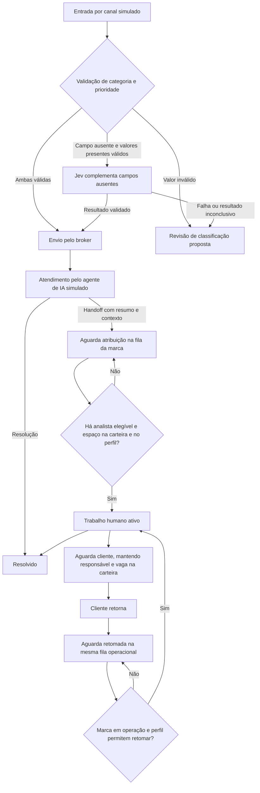

# Consolidação parcial do fluxo operacional

Este documento registra o ciclo aprovado em D014 e as questões levantadas ao
definir a V2. As regras propostas para implementação estão na
[especificação do MVP](especificacao-mvp.md). O
[registro de decisões](decisoes.md) preserva as escolhas e sua evolução.

## Regras confirmadas

| Elemento | Regra |
| --- | --- |
| Marca | Cada atendimento e sua fila atual pertencem à mesma marca. |
| Equipes | Podem atuar em várias marcas mediante autorização explícita. |
| Fila | Pertence a uma marca e pode ter várias equipes responsáveis, todas autorizadas nessa marca. |
| Fila atual | Cada atendimento em curso tem uma única fila ativa; as anteriores ficam no histórico. |
| Responsável principal | No máximo um por atendimento, podendo ser IA ou humano. |
| Analista humano | Atua em uma marca por vez; pode manter pendências de outras marcas autorizadas na V2. |
| Capacidade simultânea | Combinações configuráveis por analista, substituindo pontos numéricos. |
| Prioridade e categoria | Critérios escolhidos para as combinações; não foi adotada escala adicional de complexidade. |
| Origem da classificação | Os canais simulados enviam categoria/prioridade; a plataforma valida e usa os valores, conforme D015. |
| Campos ausentes | O Jev complementa somente categoria e prioridade ausentes na primeira entrega. |
| Carteira | Precisa de teto que inclua pendências; valores e eventuais cotas por tipo estão em aberto. |
| Troca de marca | Pode preservar casos aguardando cliente; retomada revalida marca e capacidade. |
| Visão unificada | Reúne casos autorizados para consulta, preservando suas marcas e filas. |
| Distribuição humana | Elegibilidade pelo perfil e teto de carteira; critério principal entre candidatos ainda em definição. |
| Desempate | Favorece quem está há mais tempo sem receber caso. |

## Ciclo principal aprovado e detalhamento proposto

O caminho entrada, IA, handoff, humano, espera, retomada e resolução está aprovado.
As verificações indicadas no diagrama precisam de regras de transição concretas.
Urgentes exclusivos na espera, ordem das retomadas e preparo da troca de marca
ainda precisam de definição.

Um retorno não é um novo caso e não deve duplicar sua vaga na carteira. O estado
de retomada não cria uma segunda fila operacional nem outro responsável.

## Combinações de trabalho

As regras precisam expressar alternativas, como um urgente exclusivo sozinho
ou uma combinação de básicos e intermediário. O detalhamento proposto e os
exemplos de aceitação/rejeição estão em [perfis de capacidade](perfis-de-capacidade.md).
Os exemplos não fixam os nomes/ordem das prioridades ou os limites globais da
plataforma. D012 esclarece que básico/intermediário/avançado eram prioridades e
D013 confirma o uso conjunto de prioridade e categoria.

## Questões tratadas na especificação do MVP

- Tratamento de campos inválidos, correções e falhas ou resultados inconclusivos do Jev.
- Nomes e ordem das prioridades, catálogo de categorias e condições concretas das combinações.
- Se o urgente exclusivo reserva exclusividade também enquanto aguarda cliente.
- Limites da carteira inteira e eventuais cotas por tipo, em todas as marcas.
- Critério principal entre candidatos elegíveis agora que pesos foram retirados.
- Ordem entre retomadas e novos casos e regras para evitar espera indefinida.
- Alteração de regras com casos em andamento, disponibilidade, revogação e falhas.

O fluxo de validação e complemento está documentado em [triagem e classificação](triagem-e-classificacao.md).

## Revisão de limites

A [revisão crítica](revisao-critica-e-alternativas.md) motivou a adoção da V2.
Ela permanece como análise histórica das alternativas; D011 e este fluxo
registram a escolha posterior de substituir os pesos por combinações.
