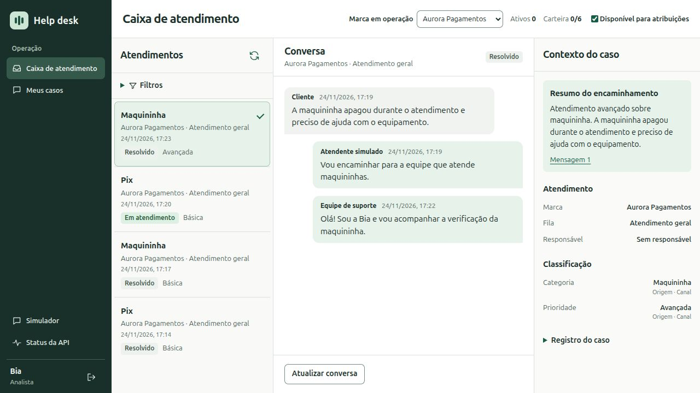

# UX01 · Caixa de atendimento e simulador

A área do analista em `/analista` reúne navegação por perfil, lista, conversa e contexto. “Meus casos” usa o filtro de responsável da API. Na supervisão, “Em revisão” aplica o filtro de classificação e “Falhas da IA” aplica o filtro de integração. A lista permite combinar marca, fila, estado, responsável, categoria e prioridade. O botão de paginação solicita a próxima página.

A conversa preserva o resumo do encaminhamento, as mensagens referenciadas e os comandos de resposta, espera e resolução. O painel de contexto mostra a origem da categoria e da prioridade informadas pela API. Correção e transferência carregam seus formulários quando o supervisor os abre. A configuração operacional continua disponível para o supervisor. As escolhas de apresentação estão em [DESIGN.md](../DESIGN.md).

## Verificação local

Execute a partir da raiz da worktree.

```sh
rtk proxy docker build -t cloudwalk-ux01-web:accept frontend
rtk proxy docker run --rm --network none cloudwalk-ux01-web:accept npm test
rtk proxy docker run --rm --network none cloudwalk-ux01-web:accept npm run build
```

O Dockerfile fixa o Node por digest e instala as dependências a partir de `frontend/package-lock.json`. Na implementação inicial, 29 testes passaram. Após a correção da revisão ampla, passaram 34, cobrindo também recibos atrasados, foco e textos de bloqueio. O build TypeScript/Vite passou. No computador usado para o desenvolvimento, o Node do sistema falhou com `ERR_NO_TYPESCRIPT` ao iniciar parte da suíte. A execução aprovada usou a imagem do projeto.

Para ver o simulador com exemplos locais, execute os comandos abaixo a partir de `frontend/` e abra [a prévia com dados locais](http://127.0.0.1:45189/?fixture=demo).

```sh
rtk npm ci
rtk npm run dev -- --host 127.0.0.1 --port 45189 --strictPort
```

Os parâmetros `?fixture=empty` e `?fixture=error` permitem percorrer estados sem histórico e de falha. O login e a operação autenticada dependem da pilha da aplicação. O [roteiro F09](f09.md) descreve os acessos e os casos de demonstração.

## Aceite integrado e publicação

O corte `3e59f4a..88d80be` foi integrado em `3c00691`, após revisão por tarefa e revisão ampla com correções aprovadas. O integrador percorreu login, correção da classificação, transferência, resposta humana, resolução, configuração e auditoria pela API real em uma pilha isolada. As verificações de layout cobriram 1440, 1024, 768 e 390 px; rascunhos e foco foram conferidos no navegador. A resposta atrasada é coberta por testes; cores forçadas foram verificadas estaticamente, sem certificação completa de acessibilidade.

A interface foi atualizada na [demonstração pública temporária](https://mirrors-labour-crafts-characteristic.trycloudflare.com), preservando túnel, API e volumes. O build de publicação e a verificação HTTPS/banco passaram. O navegador confirmou a conversa pública anterior com os quatro registros preservados. A demonstração continua com classificação fixture e atendente simulado; nenhum consumo de modelo foi habilitado. O endereço depende do computador e dos processos ligados.

[Aceite detalhado](evidencias/ux01/ux01-integrator-acceptance.md) · [Revisão final](evidencias/ux01/ux01-final-review.md) · [Correções aceitas](evidencias/ux01/ux01-final-rereview.md).



## Exercício

Abra um caso humano como o analista responsável. Digite uma resposta sem enviá-la. Em 390 px de largura, vá à lista, volte à conversa e abra o contexto. Siga uma referência do resumo e confira o foco na mensagem e o texto no compositor. Amplie para 1440 px e localize o mesmo contexto à direita da conversa.
