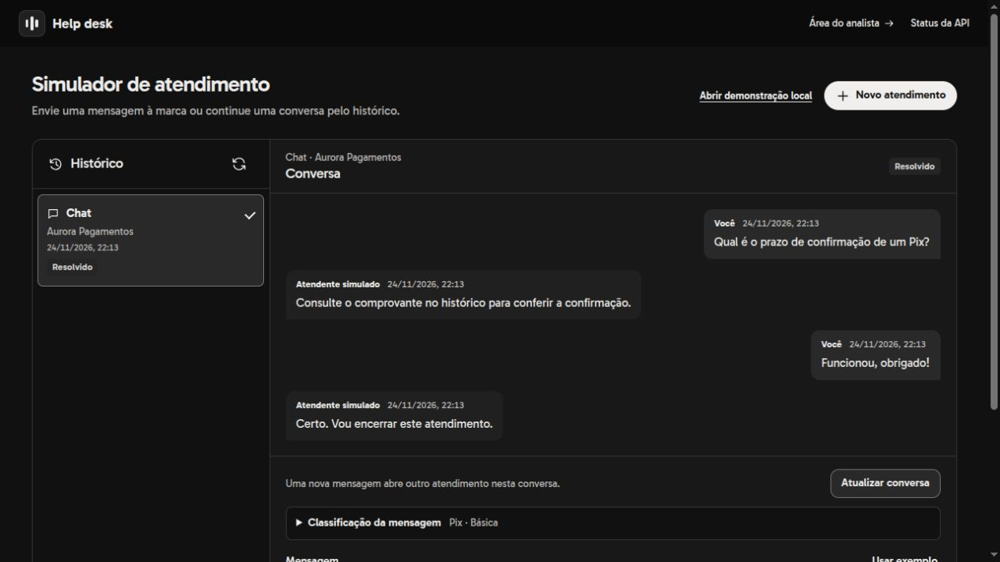

# UX02 — tema inspirado na CloudWalk

## Entrega integrada

Base `1adc941`, branch `feat/estilo-cloudwalk`, worktree
`.worktrees/ux02-cloudwalk`, implementação final `8ac8a00`, integrada localmente.
O tema foi publicado no [endereço temporário da UX02](https://tribal-louisville-container-bind.trycloudflare.com/).
Consulte o [endereço mais recente registrado na F10](f10-resultado.md#endereço-atual).

Revisões por tarefa e ampla concluídas; os quatro achados da revisão ampla foram
resolvidos. Passaram 34 testes e build no runtime fixado em `94fa3d0`. O ajuste
final `8ac8a00` mudou apenas regras de cores forçadas e documentação, com
revisão estática e diff aprovados. O build de publicação também passou no código
final. Nenhum arquivo de comportamento TS/JS foi alterado.

O integrador conferiu login, operação, configuração, simulador e tamanhos de
1440 e 390 px. O hover da aba ativa foi observado com texto `#f0efed` sobre
`#292929`, contraste 12,66:1. Cores forçadas foram revistas estaticamente, sem
confirmação visual nesse modo. As pendências históricas abaixo pertencem aos
relatórios anteriores a esse aceite.

A verificação pública concluiu dois turnos e quatro mensagens no caso
`256218e8-0b9c-429f-8dc4-a7d7a1bb4b31`, com estado Resolvido. Classificação
fixture e atendente simulado continuam ativos; não houve chamada paga de IA.
[Revisão dirigida](evidencias/ux02/ux02-final-rereview.md) ·
[Aceite do integrador](evidencias/ux02/ux02-integrator-acceptance.md).

## Alterações

- Tema escuro aplicado às superfícies global, analista, login, supervisor,
  configuração e simulador; as regras de layout e os arquivos TS/TSX não mudaram.
- Tokens de navegação, fundo, superfície, texto, controles, seleção e estados
  centralizados em `frontend/src/style.css`.
- Fonte Gabarito variável hospedada localmente com OFL, `font-display: swap`,
  origem e hash SHA-256 em `frontend/public/fonts/SOURCE.md`.
- Sem logotipo ou nome CloudWalk no produto; ícone abstrato de três barras e
  nome Help desk preservados.
- Hover da aba ativa mantém fundo e texto legíveis por regra local mais
  específica; navegação e abas usam borda pseudo-elemento `Highlight` em cores
  forçadas, mantendo o outline global reservado ao foco do teclado.
- As amostras de navegação, estado e item selecionado no sidecar seguem os pesos,
  raio e visto usados pelo produto.

## Referência e limite tipográfico

Referência consultada em 24/11/2026: [site CloudWalk](https://www.cloudwalk.io/)
e [folha CSS pública](https://cdn.prod.website-files.com/6654b3697a9d140e0ca14dcc/css/cloudwalkinc.shared.7b1bb3306.min.css).
O fundo computado é `rgb(17, 17, 17)` e a família principal computada é Cera Pro.
Cera Pro requer licença web; este repositório não possui essa licença. Gabarito
é uma aproximação geométrica livre, não uma correspondência exata. A fonte foi
obtida do commit upstream fixado em `1f3fb39d6449eefa880543f109f33ede0cd4064f`;
o SHA-256 do TTF é
`8650e2bd7747f7d74619fd7aecbcb0309e6f37b7964024f3fb15ae4833b67ca5`.

## Contraste calculado

Relações calculadas pela fórmula WCAG de luminância relativa, sobre os fundos
indicados. Texto normal excede 4.5:1 e limites de controles/foco excedem 3:1.

| Par | Contraste |
| --- | ---: |
| Texto principal `#ecebe9` / painel `#181818` | 14.90:1 |
| Texto secundário `#b9b7b4` / painel `#181818` | 8.87:1 |
| Texto secundário `#b9b7b4` / canvas `#111111` | 9.44:1 |
| Texto principal `#ecebe9` / seleção `#292929` | 12.21:1 |
| Indicador da navegação `#f0efed` / seleção `#303030` | 11.49:1 |
| Indicador das abas `#f0efed` / seleção `#292929` | 12.66:1 |
| Contorno de campo `#737373` / painel `#181818` | 3.74:1 |
| Contorno de campo `#737373` / campo `#202020` | 3.44:1 |
| Borda de seleção `#797979` / seleção `#292929` | 3.34:1 |
| Barra de rolagem `#737373` / trilha `#111111` | 3.98:1 |
| Foco `#f0efed` / canvas `#111111` | 16.43:1 |
| Texto de ação `#111111` / ação `#f0efed` | 16.43:1 |
| Espera `#f1c976` / fundo `#332b1b` | 8.89:1 |
| Falha `#ffaaa0` / fundo `#351f1d` | 8.43:1 |
| Sucesso `#a8dbb7` / fundo `#1b2c23` | 9.42:1 |
| Estado neutro `#d0cfcd` / fundo `#252525` | 9.85:1 |
| Texto da navegação selecionada `#ffffff` / fundo `#303030` | 13.20:1 |

## Verificações

- Suíte frontend no container Node fixado, reexecutada após esta revisão:
  34 testes passaram, 0 falhas, 0 ignorados.
- `npm run build` reexecutado no mesmo container: passou (`tsc --noEmit` e Vite).
- Capturas em login, analista, simulador, 390 px e 1440 px: pendentes para a
  revisão do integrador em prévia isolada.
- Auditoria final de literais antigos da paleta UX01 e do diff sem TS/TSX:
  passou; as regras preservam os arquivos de comportamento.
- A faixa clara da navegação e das abas selecionadas excede 3:1 sobre seus
  fundos. O hover usa `--surface-raised`, distinto do canvas da lista, e a
  seleção ativa mantém seu fundo, contorno e visto.
- Especificidade estática: `.configuration-tabs button[aria-pressed="true"]:hover:enabled`
  tem `(0,4,1)` e vence `.primary:hover:enabled` com `(0,3,0)`. O contraste
  renderizado da aba sob o ponteiro e a aparência em cores forçadas ficam para
  a revisão dirigida do integrador; não foram declarados como verificados aqui.
- Relatório inicial de execução: [UX02](evidencias/ux02/ux02-report.md).
